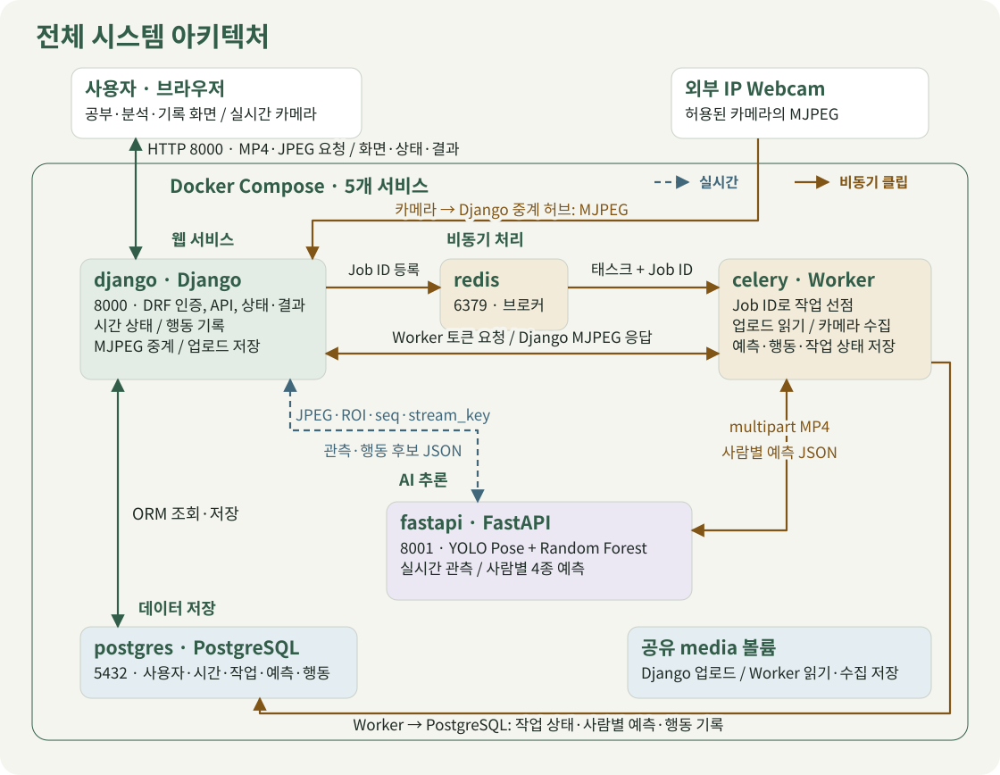
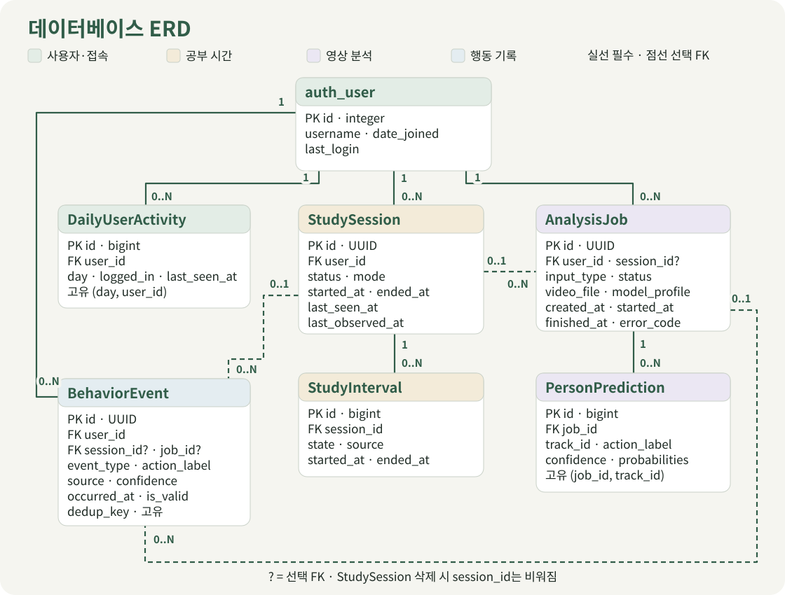
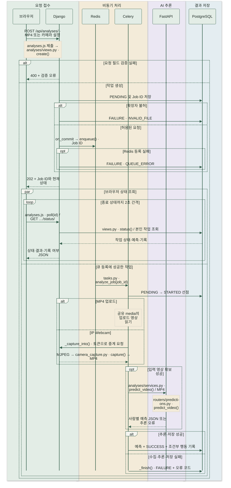
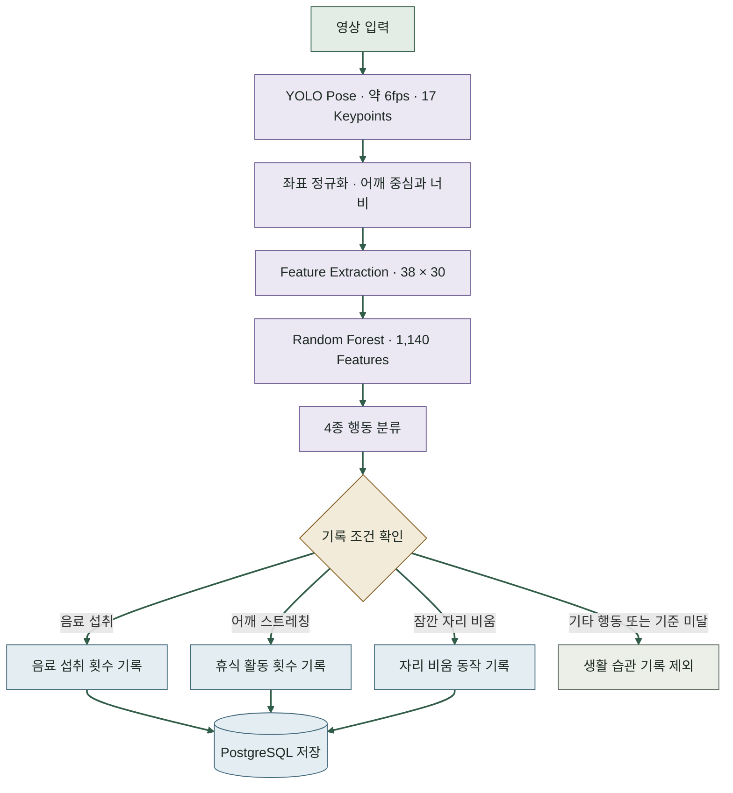
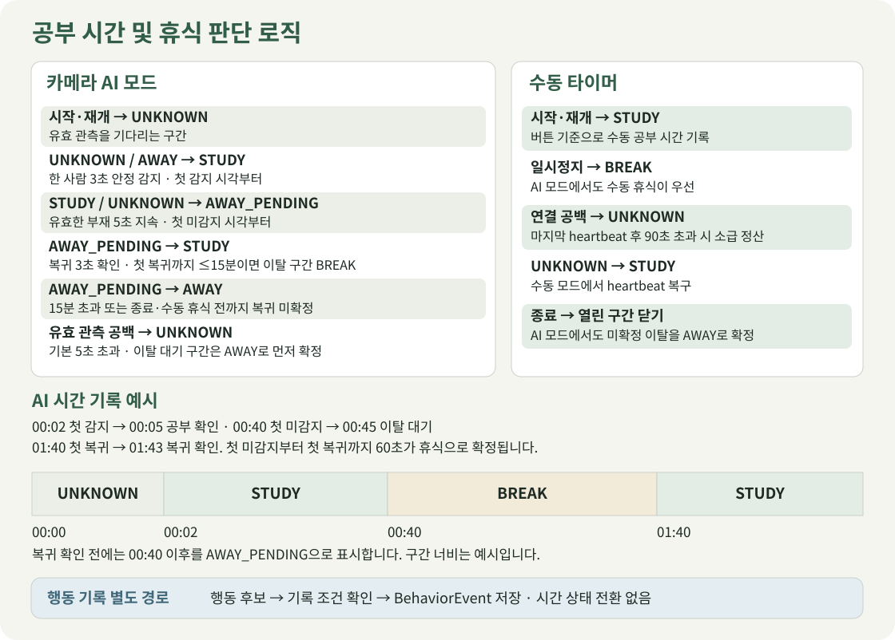

# Desk Habit Coach

공부 추정 시간과 음료·움직임을 기록하는 웹 앱입니다. 수동 타이머, 카메라 기반 집중 모드, MP4·IP Webcam 영상 분석, 최근 7일 기록과 관리자 통계를 제공합니다.

자체 학습 Random Forest 모델은 음료 섭취(`drink_return`), 어깨 스트레칭(`wave`), 잠깐 자리 비움(`walk_turn_walk`), 기타 행동(`other`)를 분류합니다. 모델 입력은 6fps 기준 30 step × 38 feature입니다. 원 교과의 제공 6종 모델은 사용자 확인에 따라 자체 학습 모델로 대체했습니다.

## 설치와 실행

Docker와 Docker Compose가 필요합니다.

```bash
cp -n .env.example .env
docker compose config --quiet
docker compose up -d --build
docker compose ps
```

처음 실행하기 전에 `.env`의 `DJANGO_SECRET_KEY`와 `POSTGRES_PASSWORD`에 고유한 값을 설정합니다. 기존 `.env`와 PostgreSQL 볼륨을 사용하는 경우 기존 접속 설정을 유지합니다. 브라우저에서 `http://localhost:8000`을 열고 회원가입합니다. 관리자 통계 계정은 `docker compose exec django python manage.py createsuperuser`로 만들 수 있습니다.

| 환경변수 | 예시·용도 |
|---|---|
| `MODEL_PROFILE` | `service` |
| `DJANGO_TIME_ZONE` | `Asia/Seoul` |
| `POSTGRES_DB`, `POSTGRES_USER` | `desk_habit` |
| `CAMERA_DESK_CAM_1_URL` | 선택. 같은 네트워크의 IP Webcam MJPEG 주소 |
| `AI_INTERNAL_TOKEN` | 선택. Django·Celery와 FastAPI에 동일한 내부 인증 토큰 적용 |

종료 시 `docker compose down`을 사용하면 PostgreSQL과 미디어 볼륨이 유지됩니다.

## 구조

Django와 DRF는 사용자 화면, 인증, 시간 상태 및 데이터 저장을 담당합니다. 클립은 Redis로 작업을 전달해 Celery에서 FastAPI 추론을 호출합니다. 실시간 프레임은 Django가 FastAPI에 전달하고 FastAPI가 YOLO Pose와 자체 RF 모델로 분석합니다. PostgreSQL은 세션, 분석 및 행동 기록을 보관합니다. [아키텍처](docs/ARCHITECTURE.md) · [AI 파이프라인](docs/AI_PIPELINE.md)

### Figure 01. 전체 시스템 아키텍처

[](docs/images/diagrams/figure-01-system.svg)

브라우저는 Django의 8000번 포트로 접속합니다. 실시간 분석은 Django가 JPEG 프레임을 FastAPI로 보내고 관측과 행동 후보를 받아 시간을 집계합니다. 클립 분석은 Redis가 전달한 Job ID를 Celery가 받아 MP4를 FastAPI에 전달한 뒤 결과를 PostgreSQL에 저장합니다.

### Figure 02. 데이터베이스 ERD

[](docs/images/diagrams/figure-02-erd.svg)

사용자는 여러 공부 세션과 분석 작업을 가질 수 있고, 각 세션에는 상태 구간이, 각 분석 작업에는 사람별 예측이 연결됩니다. 행동 기록의 세션·작업 연결은 선택이고, 로그인·접속을 담는 날짜별 활동은 사용자당 서울 날짜마다 한 행으로 저장합니다. [전체 필드 및 제약](docs/ERD.md)

### Figure 03. AI 분석 버튼 실행 흐름



유효한 작업 요청은 202와 Job ID를 반환하고, 브라우저는 해당 ID로 상태를 조회합니다. Worker는 업로드 파일을 읽거나 카메라 중계에서 MP4를 수집해 추론하며, 예측과 작업 성공 상태, 조건을 통과한 행동 기록을 함께 저장합니다. 수집·추론·저장 오류가 발생하면 작업에 실패 상태와 오류 코드를 남깁니다.

### Figure 04. AI 모델 추론 파이프라인



학습과 추론은 어깨 중심과 어깨 너비로 좌표를 정규화한 뒤, 30스텝의 38개 특징을 1,140차원으로 펼쳐 Random Forest에 입력합니다. Django는 조건을 통과한 음료 섭취와 어깨 스트레칭을 횟수로, 잠깐 자리 비움을 동작 기록으로 저장하며 기타 행동은 생활 습관 기록에서 제외합니다. 휴식과 장기 자리 비움은 시간 엔진이 이탈·복귀 시각으로 별도 판정합니다.

### Figure 05. 공부 시간 및 휴식 판단 로직

[](docs/images/diagrams/figure-05-study-time.svg)

AI 모드는 한 사람이 3초간 안정적으로 보이면 공부를, 유효한 부재가 5초 지속되면 이탈 대기를 기록합니다. 복귀가 3초간 확인되면 첫 복귀 시각을 기준으로 15분 이내의 이탈 전체를 휴식으로 확정합니다. 수동 타이머는 버튼과 연결 신호를 따르며, 음료·움직임 분류는 별도의 행동 기록을 생성합니다.

## 화면

[오늘](docs/screenshots/today.png) · [집중 모드](docs/screenshots/study.png) · [집중 모드 모바일](docs/screenshots/study-mobile.png) · [분석](docs/screenshots/analyses.png) · [기록](docs/screenshots/reports.png) · [관리자](docs/screenshots/staff.png)

## 시연 순서

1. 집중 모드를 시작하고 카메라를 켭니다. 한 사람이 3초 동안 안정적으로 감지되면 공부 상태로 전환됩니다.
2. 음료를 마시거나 한 팔을 가슴 앞으로 당기는 어깨 스트레칭을 해 행동 기록을 확인합니다.
3. 5초 이상 자리를 비운 뒤 15분 안에 돌아옵니다. 복귀가 3초간 확인되면 이탈 구간이 휴식으로 분류됩니다.
4. 기록 페이지에서 시간과 행동을 확인합니다. 잘못 인식된 행동은 오인식으로 표시할 수 있습니다.
5. 분석 화면에서 5초 이상 MP4를 제출하고 작업 상태와 사람별 결과를 확인합니다. 작업 상세는 기록 페이지에서도 열 수 있습니다.
6. 관리자 계정으로 관리자 통계의 예측 및 상태 분포를 확인합니다.

## 개인정보와 한계

집중 모드의 원본 프레임은 저장하지 않고 시간과 행동 결과를 저장합니다. 직접 업로드하거나 IP Webcam으로 수집한 클립은 서버 미디어 볼륨에 작업 파일로 보관되며, 분석 작업을 삭제하면 연결된 결과와 파일도 삭제됩니다.

AI 공부 시간은 사람 감지를 바탕으로 추정합니다. 가림, 다중 인물, 연결 끊김은 확인 불가로 처리합니다. 행동은 오인식될 수 있으며 음료는 용량 없이 횟수만 기록합니다. 잠깐 자리 비움은 일어나 화면을 벗어났다가 돌아오는 학습 동작의 표시명입니다. 휴식과 장기 자리 비움은 유효한 부재와 복귀 관측 시각으로 판단합니다. [학습 자료 확인](docs/TRAINING_REPORT.md#서비스-표시명과-학습-동작) 선택 기능인 휴대폰 감지는 공부 시간을 차감하지 않습니다. 80%는 학습에 포함된 3명의 사람 단위 교차검증 결과입니다.

## 검증 결과

[최종 테스트 보고서](docs/FINAL_TEST_REPORT.md) · [테스트 케이스](docs/TEST_CASES.md)
