# Desk Habit Coach

## 1. 프로젝트 소개

교과 10 영상 분석 웹 앱입니다. 사용자가 MP4를 업로드하면 사람별 동작 분류 결과를 확인할 수 있습니다. IP Webcam 수집, 수동·카메라 기반 공부 타이머, 습관 기록, 개인 및 관리자 통계가 같은 앱에서 제공됩니다. 제출 모델은 자체 학습한 Random Forest 4종입니다.

## 2. 실행 방법

Docker와 Docker Compose가 필요합니다. 기존 설치의 `.env`와 PostgreSQL 접속 설정은 그대로 사용합니다.

```bash
cp -n .env.example .env
docker compose config --quiet
docker compose up -d --build
docker compose ps
docker compose exec django python manage.py createsuperuser
```

첫 기동 전에 `.env`의 `DJANGO_SECRET_KEY`와 `POSTGRES_PASSWORD`를 설정합니다. Django 컨테이너 시작 명령이 `migrate --noinput`과 `collectstatic --noinput`을 순서대로 실행한 뒤 Gunicorn을 시작합니다. Celery는 Django의 healthcheck가 통과한 뒤 시작합니다. PostgreSQL 데이터는 `pgdata`, 작업 영상은 `media` 볼륨에 저장됩니다.

| 환경변수 | 용도 |
| --- | --- |
| `DJANGO_SECRET_KEY`, `DJANGO_ALLOWED_HOSTS`, `DJANGO_TIME_ZONE` | Django 비밀 키, 서비스 호스트, 시간대(기본 Asia/Seoul) |
| `POSTGRES_DB`, `POSTGRES_USER`, `POSTGRES_PASSWORD` | PostgreSQL 데이터베이스와 계정 |
| `MODEL_PROFILE=service`, `MAX_UPLOAD_MB=50` | 자체 학습 모델과 영상 크기 제한 |
| `AI_INTERNAL_TOKEN` | 선택. Django·Celery·FastAPI가 동일한 내부 인증 토큰 사용 |
| `CAMERA_DESK_CAM_1_URL` | 선택. 서버에서 도달 가능한 IP Webcam MJPEG 주소 |
| `DEFAULT_CAPTURE_SECONDS=8`, `FASTAPI_TIMEOUT=180` | 카메라 기본 수집 초와 영상 추론 HTTP 읽기 제한 |
| `EVENT_THRESHOLD_DRINK`, `EVENT_THRESHOLD_MOVEMENT` | 습관 기록 기준. 예제 기본값은 각각 0.5 |

RF 파일 세 개를 `ai_service/models/service/`에 둡니다. Compose가 이 디렉터리를 FastAPI의 `/app/models/service/`에 읽기 전용으로 연결합니다.

- `rf_action_baseline.joblib`
- `rf_feature_columns.json`
- `rf_training_info.json`

| 화면 | 주소 |
| --- | --- |
| 가입·로그인 | http://localhost:8000/accounts/signup/ · http://localhost:8000/accounts/login/ |
| 사용자 | http://localhost:8000/dashboard/ · http://localhost:8000/analyses/ · http://localhost:8000/study/ · http://localhost:8000/reports/ |
| 관리자 통계·Django Admin | http://localhost:8000/staff/dashboard/ · http://localhost:8000/admin/ |

## 3. 시스템 아키텍처

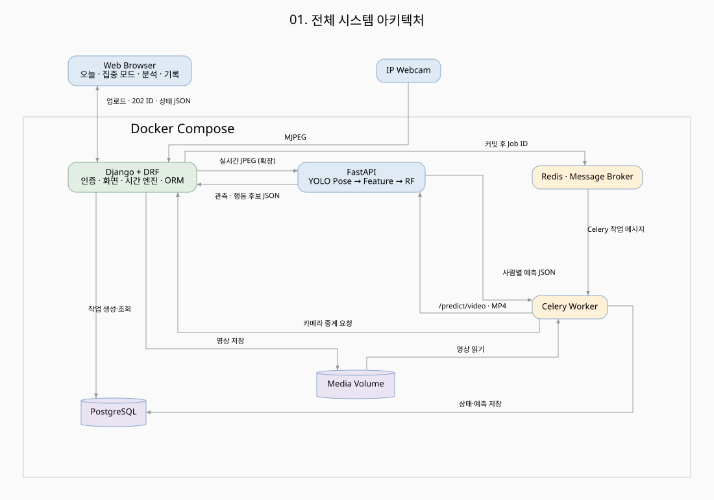

Django가 업로드 파일과 작업을 저장하고 Redis에 작업 ID를 보냅니다. Celery Worker가 공유 미디어의 MP4를 FastAPI로 전송하고 PostgreSQL에 예측을 저장합니다. IP Webcam은 작업 입력을 준비하고, 실시간 JPEG는 Django와 FastAPI 사이의 별도 API를 사용합니다. [아키텍처](docs/ARCHITECTURE.md)

## 4. 데이터베이스 ERD

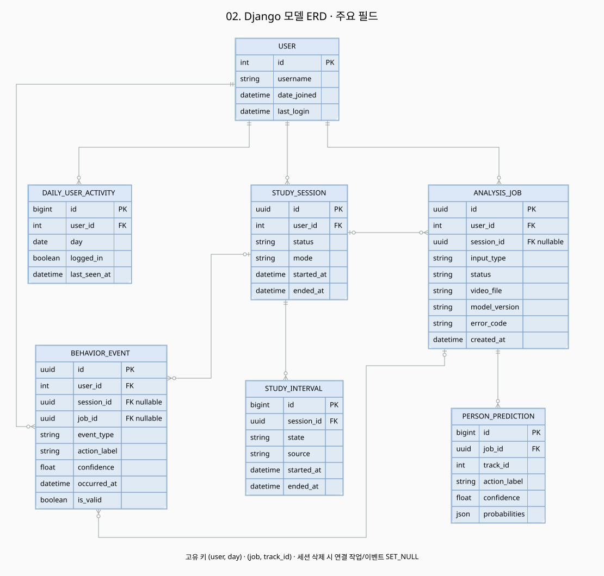

사용자별 Job과 공부 세션을 저장하며 Job에는 사람별 예측, 세션에는 상태 구간이 연결됩니다. 행동 기록은 Job 또는 세션을 선택적으로 참조합니다. [전체 필드·삭제 정책](docs/ERD.md)

## 5. AI 분석 버튼 흐름

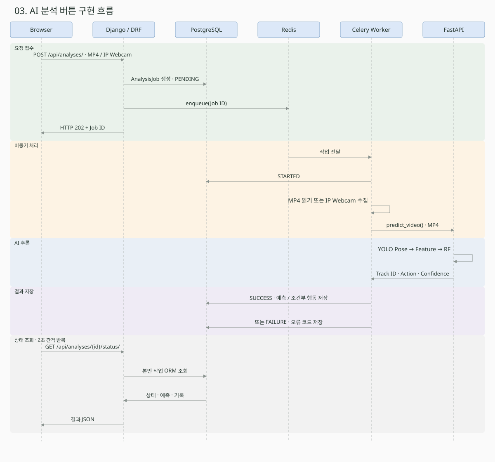

`analyses.js`가 `POST /api/analyses/`를 보내면 DRF가 입력을 검증하고 작업을 생성합니다. 202와 작업 ID로 `GET /api/analyses/{id}/status/`를 조회합니다. `analyze_job`이 PENDING을 선점하고 `run_video_job`이 영상을 추론해 상태와 예측을 저장합니다. 잘못된 파일 확장자는 큐에 넣지 않고 FAILURE로 저장합니다. [API 명세](docs/API_SPECIFICATION.md)

## 6. AI 모델 및 입력 형식

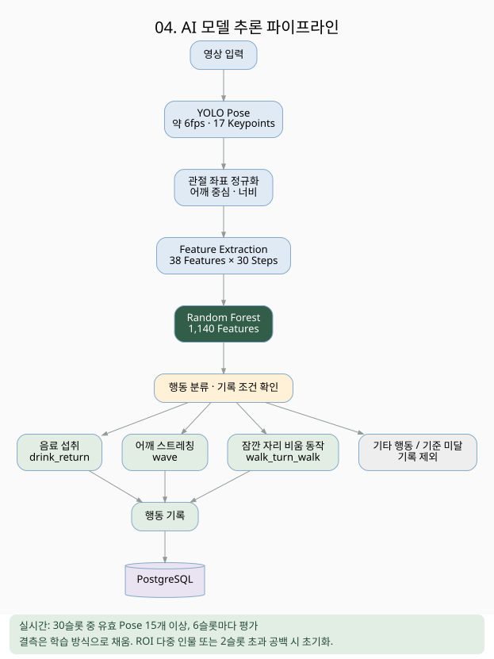

| 항목 | 형식 |
| --- | --- |
| 자체 RF 클래스 | `drink_return` 음료 섭취, `wave` 어깨 스트레칭, `walk_turn_walk` 잠깐 자리 비움, `other` 기타 |
| Feature·Sequence | YOLO Pose COCO 17 Keypoints. 어깨 중심·너비 정규화 좌표 34개와 각도 4개로 스텝당 38개. 목표 6fps, 30스텝(약 5초), stride 6, 1,140차원 |
| MP4 업로드 | 기본 최대 50 MB, 샘플링 후 최소 30스텝. Django 허용 확장자는 `.mp4`, `.mov`, `.avi`, `.mkv` |
| IP Webcam | 기본 8초, 허용 범위 5~15초. Django가 중계하는 MJPEG를 Worker가 MP4로 모음 |
| FastAPI 영상 | `POST /predict/video` multipart `file` → 프로필·버전, `predictions[]`(Track ID, 라벨, 점수, Window 수, 전체 확률), 오류 정보, 처리 시간 |
| FastAPI 실시간 | `POST /predict/frame` multipart `frame` JPEG(최대 2 MiB), 선택 `roi/stream_key/seq/detect_phone` → 사람·휴대폰, 관측, 행동 후보, 버퍼 정보 |

클립은 유효 Track별 활성 Window 확률을 평균합니다. 실시간은 단일 ROI 대상의 최근 유효 Window를 사용합니다. [AI 파이프라인](docs/AI_PIPELINE.md)

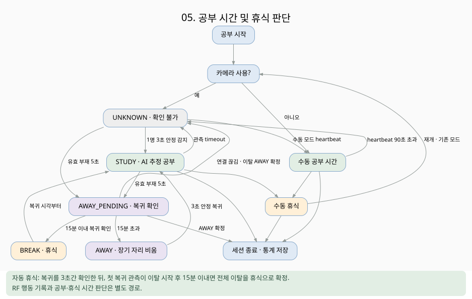

공부·휴식은 착석과 이탈·복귀 관측으로 정산합니다. 집중 모드 프레임은 메모리에서 처리하고 업로드·수집 영상은 작업 파일로 저장합니다.

## 7. 실행 결과 및 검증

[최종 테스트 보고서](docs/FINAL_TEST_REPORT.md) · [테스트 케이스](docs/TEST_CASES.md)

격리 Docker 프로젝트에서 Django 97개와 FastAPI 19개 테스트가 통과했습니다. 5개 서비스를 재시작한 뒤 동일 분석 작업, 예측 두 건과 MP4 해시를 확인했습니다.

### MP4 분석 성공

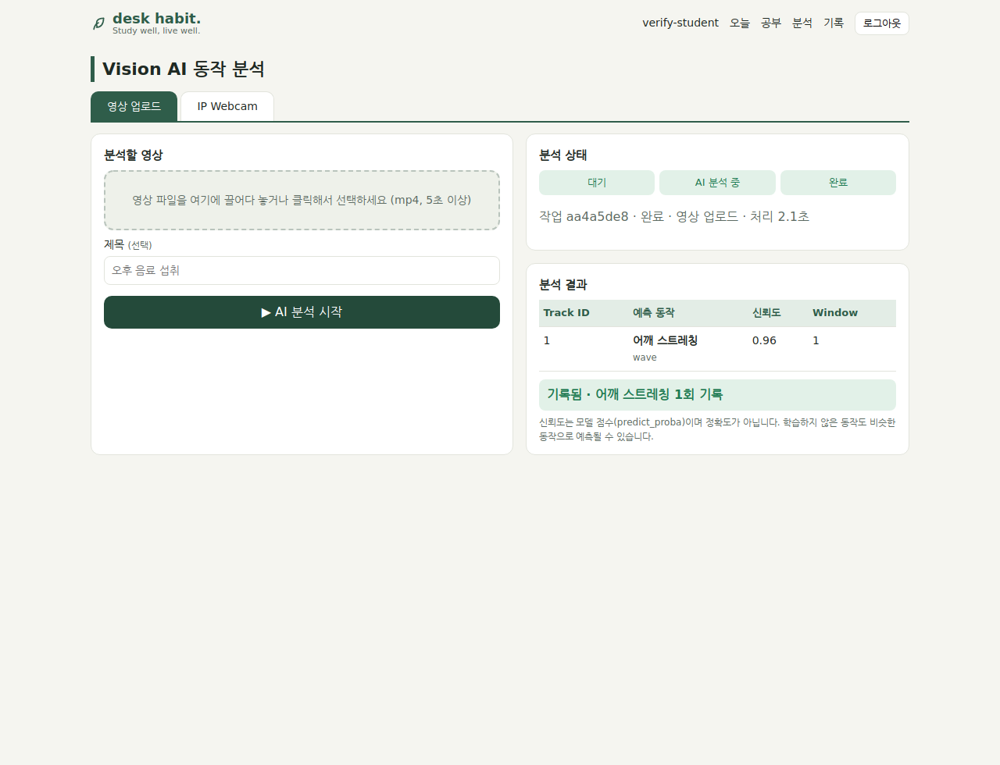

6초·30fps 단일 인물 MP4 입력에서 SUCCESS, Track 1과 움직임 기록이 표시됐습니다.

### 다중 인물 분석

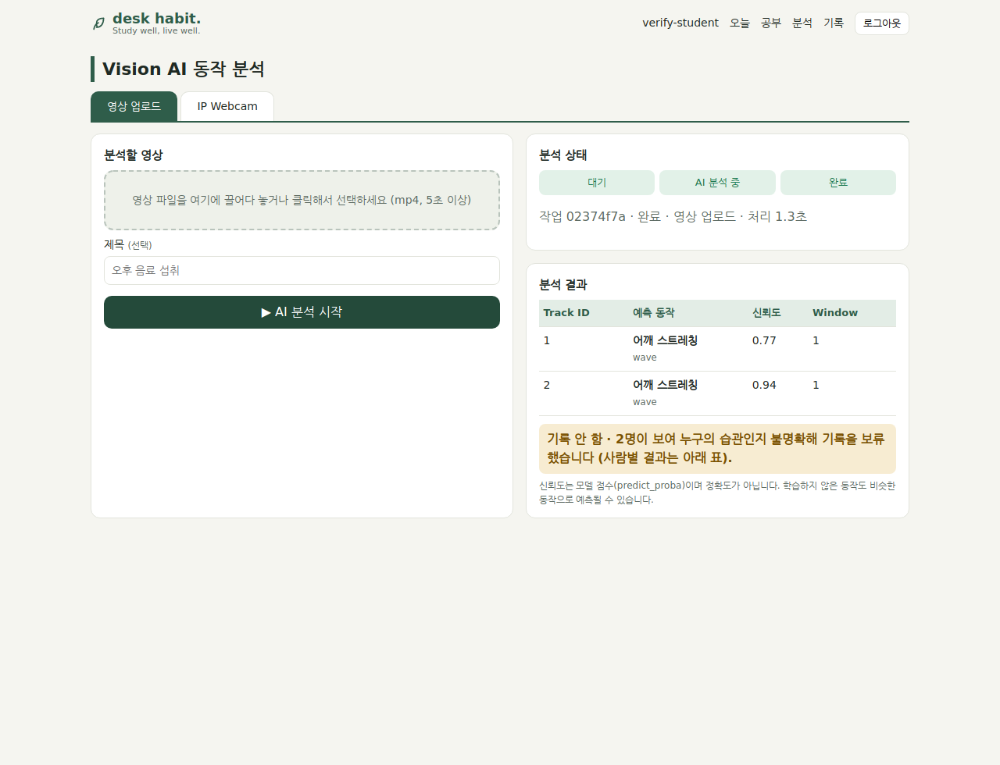

6초·30fps 다중 인물 MP4 입력에서 Track 1·2가 표시됐고 개인 습관 기록을 보류했습니다.

### 잘못된 파일

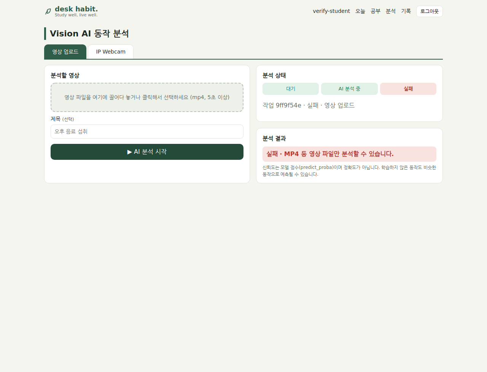

TXT 제출에 202 작업 응답을 받고 저장된 상태가 FAILURE, 오류 코드가 INVALID_FILE임을 확인했습니다.

### IP Webcam

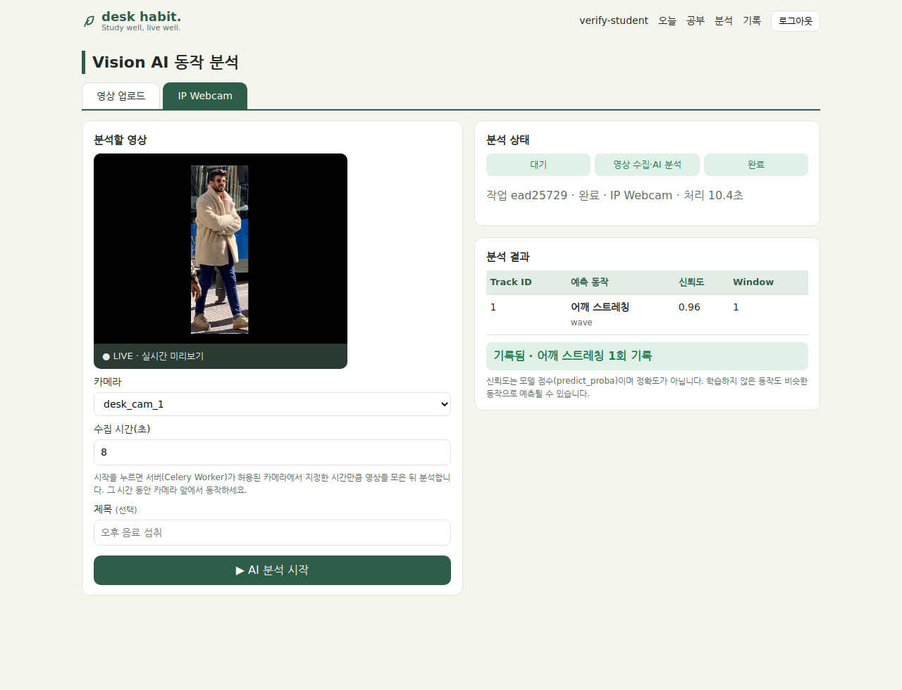

격리 MJPEG 테스트 소스의 정지 1인 프레임을 기본 8초간 수집해 MP4로 분석했고, SUCCESS와 Track 1을 확인했습니다.

설정된 물리 장치는 CAMERA_UNAVAILABLE을 반환했습니다. 실제 장치의 수집·분석 성공은 NOT RUN입니다.

### 사용자 대시보드

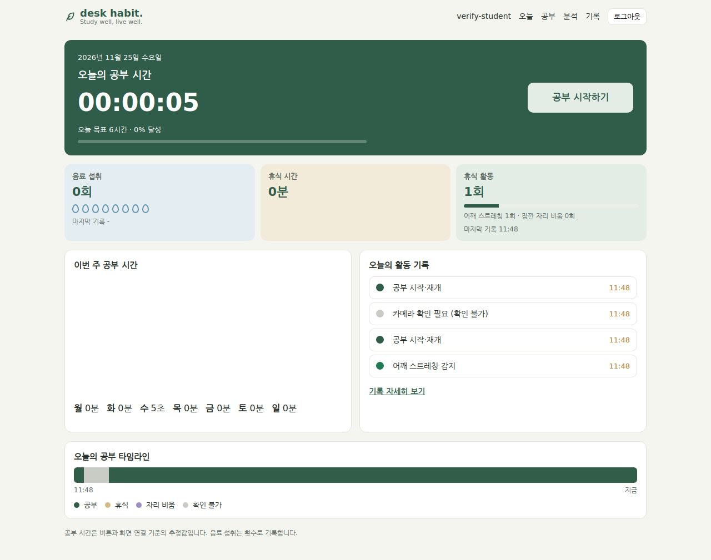

가상 카메라로 진행한 세션을 종료한 뒤 오늘 공부 시간과 시간 구간을 확인했습니다.

### 공부 및 실시간 분석

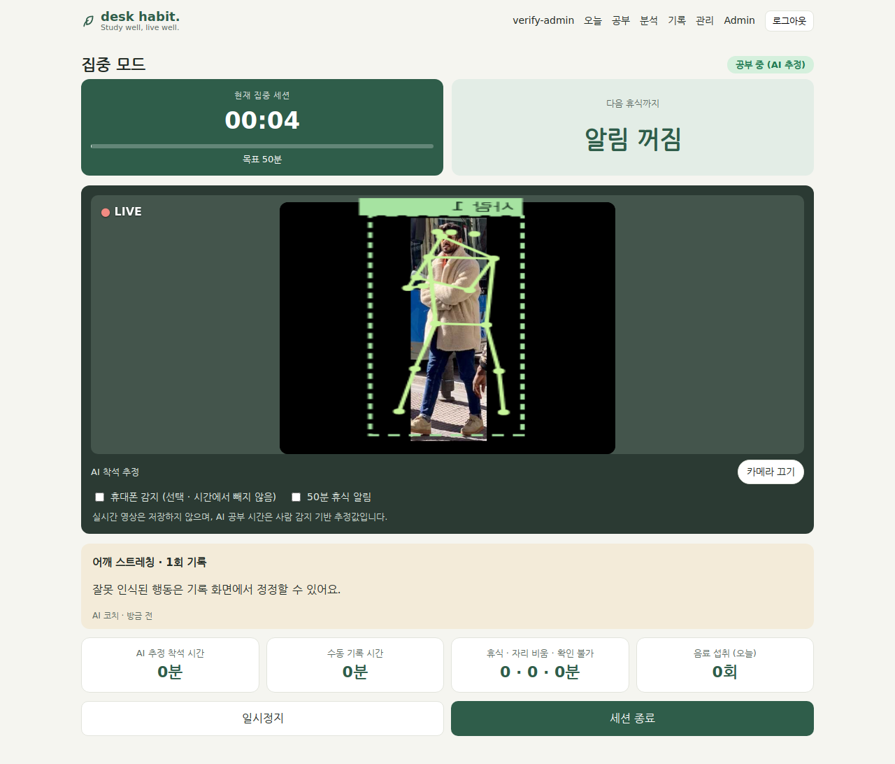

640×480 정지 1인 영상의 가상 카메라 입력에서 STUDY 상태와 MOVEMENT 이벤트 저장을 확인했습니다.

### 관리자 대시보드

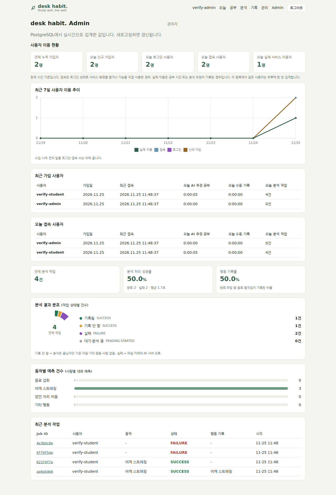

관리자 계정에서 분석 결과 분포와 최근 작업을 확인했고, 일반 계정은 403을 받았습니다.
