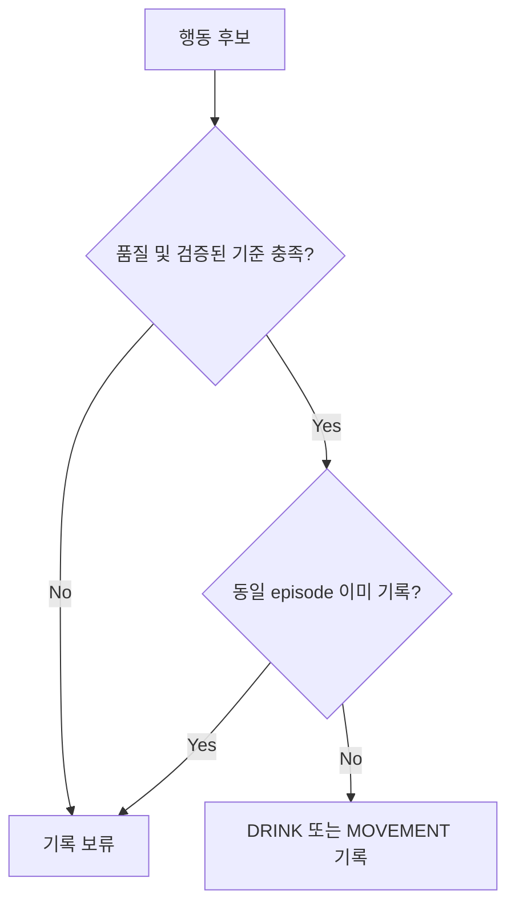

# AI 파이프라인 v2.0
기존 day6 RF joblib, rf_feature_columns.json, rf_training_info.json, day7~8 Pose/Feature/Tracking 재사용. 실제 classes_, n_features_in_, sequence_steps 및 feature 순서 검증. 30×38=1140 기준. 재학습은 교과 범위 밖.

| ID | 라벨 | 기록 |
|---|---|---|
| A001 | bend_return | 허리 움직임 |
| A002 | leg_raise_lower | 다리 움직임 |
| A003 | walk_turn_walk | 걷기 활동 |
| A004 | drink_return | 음료 섭취 동작 |
| A005 | sit_stand | 기립 활동 |
| A006 | wave | 팔 움직임 |

## 두 분석 분기 (Pose 공유)
1. 동작: 사람별 관절 → 기존 정규화·38 features → 30 step → RF → 윈도우 집계 → 품질/신뢰도/지속성 필터 → 이벤트 후보.
2. 시간: 지정 착석 ROI 내 단일 대상 존재 및 관절 품질 → 상태 후보. 상반신만 보이는 경우 착석 자체를 확정할 수 없으므로 착석 영역 존재로 표시. 다중 인물·가림·연결 장애는 UNKNOWN. 자리 비움은 정상 프레임에서 ROI 대상이 없을 때만 판단.

## 의사결정

RF는 폐쇄형 6종 분류이므로 미학습 행동도 높은 점수로 오분류 가능. UNKNOWN은 서비스 보류 상태이지 RF 클래스가 아니다. 초기 threshold는 검증 데이터로 결정하고, 동작 종료/재진입 및 cooldown을 조합해 중복 제거한다. 단순 연속 window 개수를 행동 횟수로 세지 않는다. 수분량·실제 집중·올바른 스트레칭을 추정하지 않는다.

실시간 프레임은 학습 당시 sampling cadence에 맞춰야 한다. 처리량 부족 시 행동 인식을 비활성화하고 수동 클립 분석으로 대체한다. 상태 감지 초기값: 복귀 3초, 부재 5초, heartbeat 5초 초과 UNKNOWN(검증 후 조정). 서버 시각 기준 상태 구간 계산, 마지막 유효 관측 이후 미확인 시간은 UNKNOWN으로 정산.
