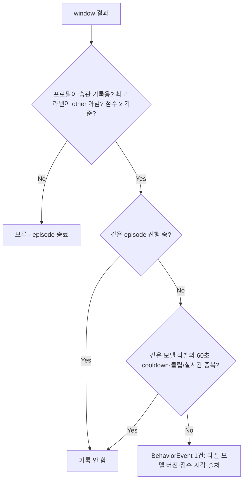

# AI 파이프라인 (구현 기준)

## 모델 프로필
`ai_service/models/<프로필>/`에 파일 3개(`rf_action_baseline.joblib`, `rf_feature_columns.json`, `rf_training_info.json`). `.env`의 `MODEL_PROFILE`로 선택하고 FastAPI를 재시작한다. 로딩 시 클래스, 1140차원, 30 step × 38 feature, 6fps, stride 6을 검사하며 다르면 서버가 시작하지 않는다.

| 프로필 | 클래스 | 용도 | 상태 |
|---|---|---|---|
| service | drink_return, wave, walk_turn_walk, other | 습관 자동 기록 | 자체 촬영 학습 (`rf-2026-11-24-other`) |
| course | 교과 제공 6종 | 기존 설정과 데이터 읽기 호환 | 제출 및 기본 실행 범위에서 제외 |

원 교과 요구의 제공 모델 6종은 사용자 확인에 따라 자체 학습 4종으로 대체했다. `MODEL_PROFILE=service`가 기본값이다. 모든 분석 결과에 `model_profile`·`model_version`을 저장한다.

| 모델 라벨 | 서비스 표시명 | 생활 습관 기록 |
|---|---|---|
| `drink_return` | 음료 섭취 | 1회 (DRINK, 용량 미측정) |
| `wave` | 어깨 스트레칭 | 활동 1회 (MOVEMENT) |
| `walk_turn_walk` | 잠깐 자리 비움 | 동작 1회 (MOVEMENT) |
| `other` | 기타 행동 | 제외 (NG 영상으로 학습) |

잠깐 자리 비움은 이탈·복귀 동작의 분류 결과다. 시간 엔진은 사람 감지로 이탈·복귀 시각을 확인한 뒤 휴식 또는 장기 자리 비움으로 분류한다. [학습 자료 확인](TRAINING_REPORT.md#서비스-표시명과-학습-동작)

## Feature (학습·추론 공통 코드)
YOLO11n-pose 17관절 → 어깨 중심·어깨 너비 정규화 좌표 34 + 팔꿈치·어깨 각도 4 = 38/step. 6fps × 30 step = 5초 window, stride 6. 클립은 움직임이 최대의 50% 미만인 window를 제외(`active_windows`)하고 확률을 평균한다.

## 두 분기
1. **시간(착석)**: ROI 안 사람 중심 기준. 코·양 어깨 관절 신뢰도 평균 ≥ 0.5면 품질 통과. ROI 안 품질 통과 1명 = `presence_candidate`, 0명 + 품질 통과 = 부재, 그 외(다중 인물·가림·흐림) = 불명확 → 시간 상태 머신(ARCHITECTURE.md).
2. **행동**
   - 클립: Celery → `/predict/video` → 사람별 결과. 사람이 2명 이상이면 결과는 보여 주되 개인 습관 기록은 보류.
   - 실시간: `/predict/frame`에 `stream_key`·`seq`(ms) 전달. 착석 대상이 정확히 1명일 때만 그 사람의 38 feature를 세션 버퍼에 쌓는다. 너무 빠른 프레임(< 0.5 step)은 건너뛰고, 2 step 넘게 비거나 대상이 불명확하면 버퍼를 비운다(빈 step 복제 없음). 30 step이 차면 6 step마다 `action_candidates`. 버퍼 TTL 60초, 최대 20개, 재시작 시 초기화.

## 기록 결정

기준값 `EVENT_THRESHOLD_DRINK=0.56`, `EVENT_THRESHOLD_MOVEMENT=0.64`는 학습 데이터 교차검증의 **초기 후보값**이다. 별도 검증 데이터로 확정해야 한다. RF는 폐쇄형 분류라 미학습 행동도 높은 점수가 나올 수 있어 `other` 클래스와 기준값으로 보류한다.
