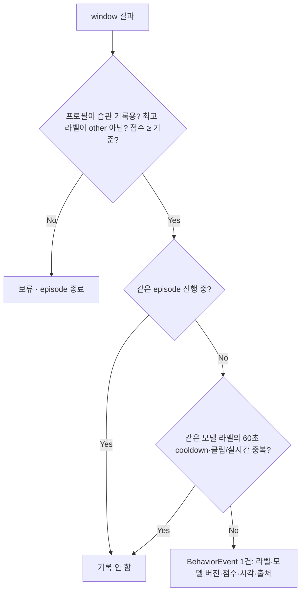

# AI 파이프라인 (구현 기준)

## 모델 프로필
`ai_service/models/<프로필>/`에 파일 3개(`rf_action_baseline.joblib`, `rf_feature_columns.json`, `rf_training_info.json`). `.env`의 `MODEL_PROFILE`로 선택하고 FastAPI를 재시작한다. 로딩 시 클래스, 1140차원, 30 step × 38 feature, 6fps, stride 6을 검사하며 다르면 서버가 시작하지 않는다.

| 프로필 | 클래스 | 용도 | 상태 |
|---|---|---|---|
| service | drink_return, wave, walk_turn_walk, other | 습관 자동 기록 | 자체 촬영 학습 (`rf-2026-11-24-other`) |
| course | 교과 제공 6종 | 프로필 및 과거 결과 호환 | 6종 모델 산출물 미제공, 현재 실행 미검증 |

원 교과 요구의 제공 모델 6종은 사용자 확인에 따라 자체 학습 4종으로 대체했다. `MODEL_PROFILE=service`가 기본값이다. 모든 분석 결과에 `model_profile`·`model_version`을 저장한다.

| 모델 라벨 | 서비스 표시명 | 생활 습관 기록 |
|---|---|---|
| `drink_return` | 음료 섭취 | 1회 (DRINK, 용량 미측정) |
| `wave` | 어깨 스트레칭 | 활동 1회 (MOVEMENT) |
| `walk_turn_walk` | 잠깐 자리 비움 | 동작 1회 (MOVEMENT) |
| `other` | 기타 행동 | 제외 (NG 영상으로 학습) |

잠깐 자리 비움은 이탈·복귀 동작의 분류 결과다. 시간 엔진은 사람 감지로 이탈·복귀 시각을 확인한 뒤 휴식 또는 장기 자리 비움으로 분류한다. [학습 자료 확인](TRAINING_REPORT.md#서비스-표시명과-학습-동작)

## Feature (학습·추론 공통 코드)
YOLO11n-pose 17관절 → 어깨 중심·어깨 너비 정규화 좌표 34 + 팔꿈치·어깨 각도 4 = 38/step. 6fps × 30 step = 5초 window, stride 6. 클립은 움직임이 최대의 50% 미만인 window를 제외(`active_windows`)하고 확률을 평균한다.

## 두 분기
1. **시간(착석)**: ROI 안 사람 중심 기준. 코·양 어깨 관절 신뢰도 평균 ≥ 0.5면 품질 통과. ROI 안 품질 통과 1명 = `presence_candidate`, 0명 + 품질 통과 = 부재, 그 외(다중 인물·가림·흐림) = 불명확 → 시간 상태 머신(ARCHITECTURE.md).
2. **행동**
   - 클립: Celery → `/predict/video` → 사람별 결과. 사람이 2명 이상이면 결과는 보여 주되 개인 습관 기록은 보류.
   - 실시간: `/predict/frame`에 `stream_key`·`seq`(ms)를 전달한다. 프레임을 6fps 슬롯에 배정하고, 행동 대상은 ROI 안 한 사람으로 제한하며, 시간 판정의 코·어깨 평균 기준과 별개로 학습과 같은 양 어깨 신뢰도 기준(각 0.3)을 사용한다. 대상이 없거나 관절을 추출하지 못한 슬롯은 결측으로 남긴다. 30슬롯 중 유효 Pose가 15개 이상이면 학습과 같은 `windows()`로 결측을 채워 추론한다. 6슬롯마다 다음 Window를 평가하며, 2슬롯 초과 전송 공백·다중 인물(ROI 안)에서는 버퍼를 초기화한다. 버퍼 TTL은 60초, 최대 20개다. 클립은 Track ID별로 활발한 Window를 고른 뒤 확률을 평균하고, 실시간은 들어온 Window를 순서대로 판정한다.

## 기록 결정

기준값 `EVENT_THRESHOLD_DRINK=0.56`, `EVENT_THRESHOLD_MOVEMENT=0.64`는 학습 데이터 교차검증의 **초기 후보값**이다. 별도 검증 데이터로 확정해야 한다. RF는 폐쇄형 분류라 미학습 행동도 높은 점수가 나올 수 있어 `other` 클래스와 기준값으로 보류한다.

## 개발 로그

`.env`에서 `REALTIME_DEBUG=1`을 설정하고 Django 컨테이너를 재생성한 뒤 `docker compose logs -f django`를 확인한다. `LOG_LEVEL`은 `INFO` 이상 상세하게 설정한다. 로그에는 모델 버전, 4종 확률과 최고 라벨, 기존 기준값 및 행동 그룹 판정 점수, 유효 Pose 수와 버퍼 상태, 관측 및 공부 상태, 기록·거부 이유가 나온다. 유효한 Window가 없으면 확률은 비어 있다. 프레임 이미지나 관절 좌표는 출력하지 않는다.

## 최적화 후 공통 추론 호출

`routers/predictions.py`의 `predict_video`는 `pose_pipeline.track_people`과 `action_inference.predict_people`을 호출한다. `predict_frame`은 `pose_pipeline.predict_pose`와 `StreamBuffers.add`를 거쳐 `action_inference.predict_candidates`를 호출한다. 두 경로는 `predict_probabilities`의 클래스 순서 RF 확률 및 평균을 공유한다. 실시간 평균은 단일 Window이며, 기존 정렬과 4자리 반올림을 유지한다. Pose Lock은 영상 전체의 tracker 일관성을 보호하며 휴대폰 detector의 별도 Lock은 공유 Pose를 점유하지 않는다.
