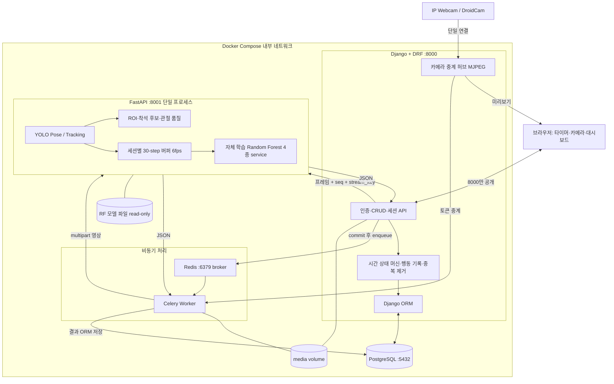
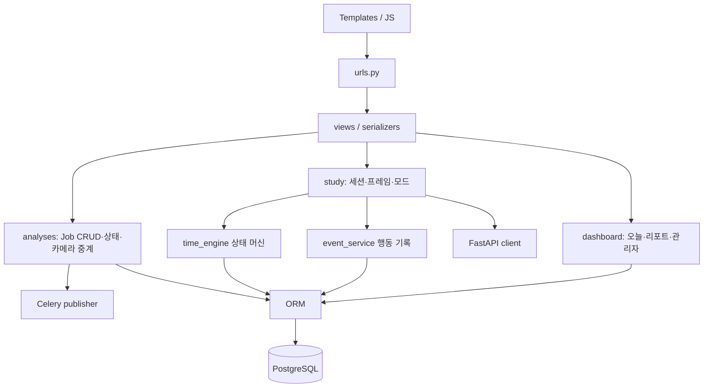
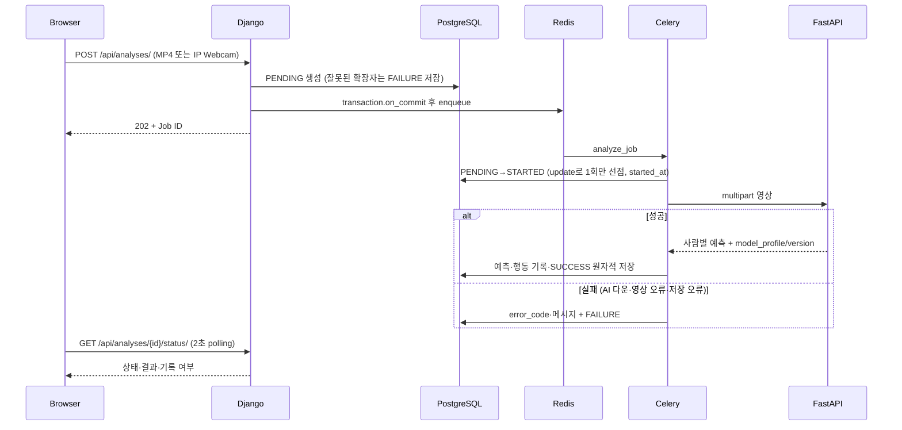
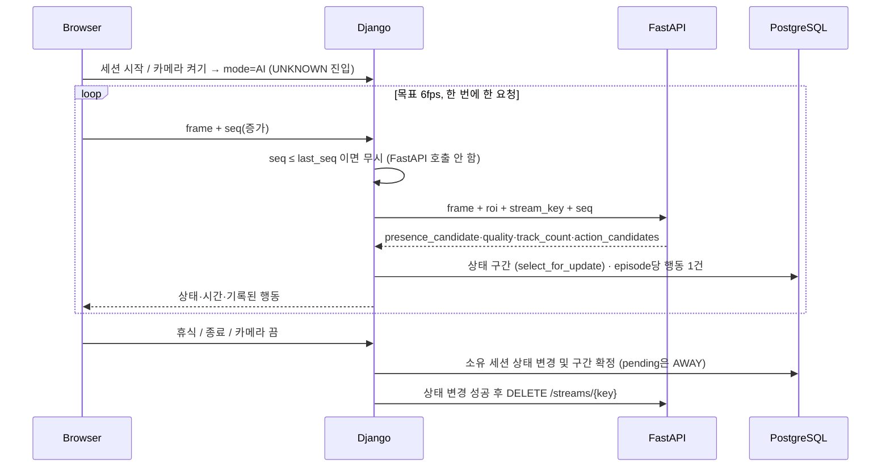
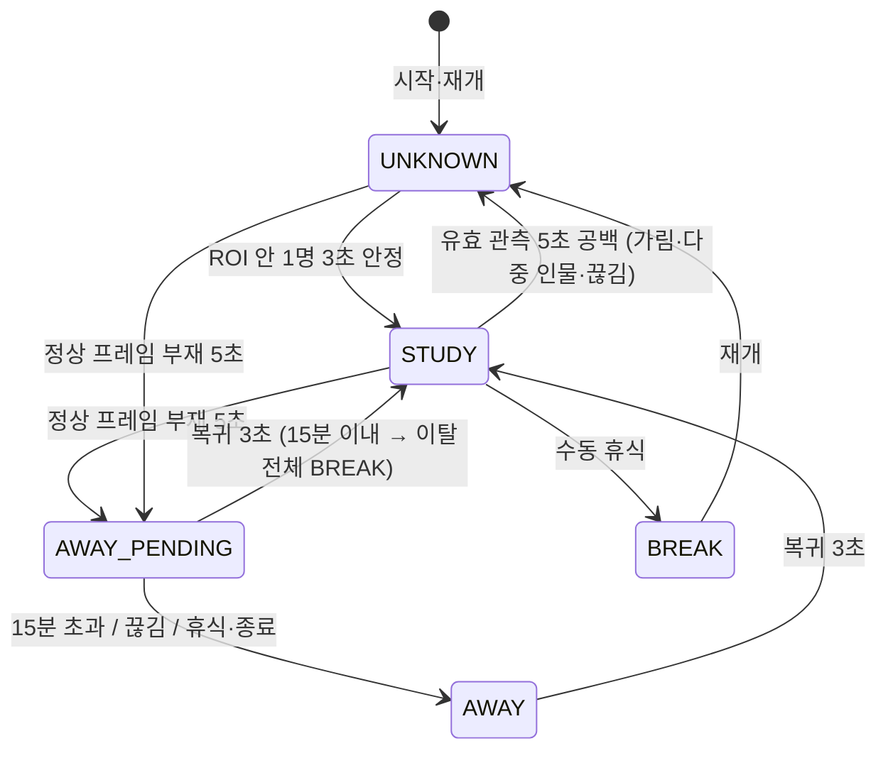
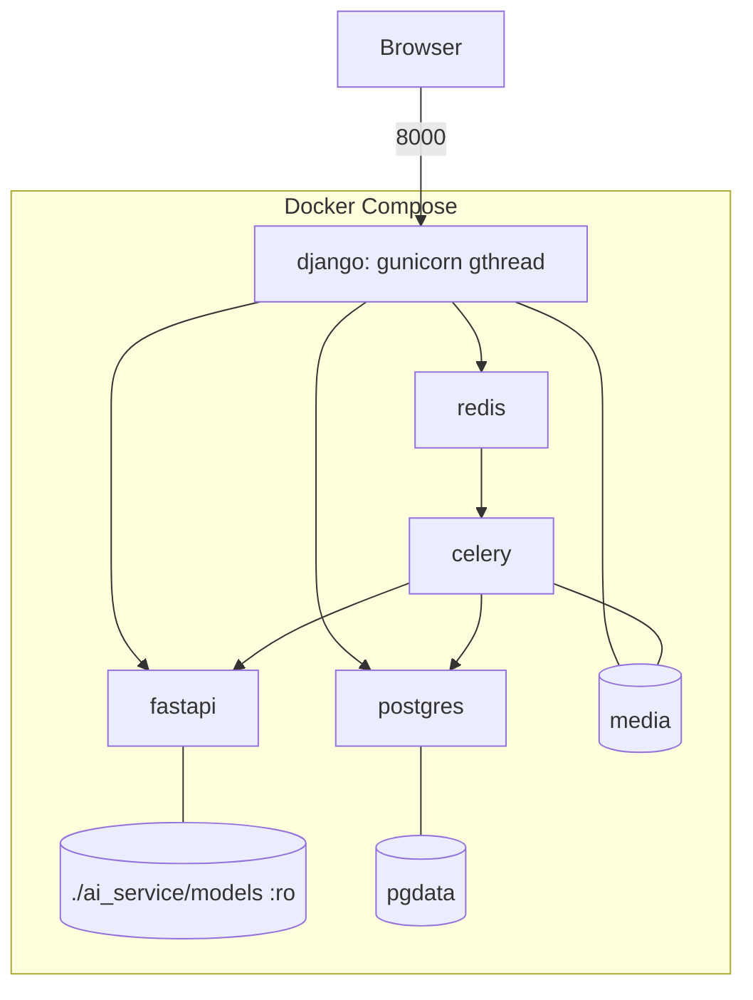

# 시스템 아키텍처 (구현 기준, 2026-11-25)

## 전체 시스템 — Docker Compose 5개 서비스

- FastAPI는 DB와 media 볼륨에 접근하지 않는다. 영상은 Celery가 **multipart**로 보낸다.
- DroidCam은 동시에 1곳만 접속 가능하므로 Django **카메라 중계 허브**가 카메라에 한 번만 연결해 미리보기(로그인 사용자)와 Celery 수집(HMAC 토큰)에 나눠 준다. 카메라 주소는 브라우저에 보내지 않는다.
- Django·Celery → FastAPI는 선택적 내부 토큰(`AI_INTERNAL_TOKEN`, `X-Internal-Token`)으로 보호한다. `/health`는 인증 없이 열려 있다.

## Django 내부

## 클립 비동기 시퀀스 (교과 필수)

Worker가 죽어 STARTED로 남은 작업은 Celery 시간 제한 + 1분이 지나면 Worker 시작 시 전체를, 상태 조회 시에는 해당 작업을 `WORKER_LOST` FAILURE로 정산한다.

## 실시간 세션 시퀀스 (AI 모드)

브라우저는 초당 약 6회 전송을 시도하고 진행 중인 요청이 있으면 건너뛴다. 처리율은 장치와 연결에 따라 달라진다. 실제 측정은 [최종 테스트 보고서](FINAL_TEST_REPORT.md)를 참조한다. 원본 프레임은 저장하지 않는다. 페이지를 떠나면 카메라 track을 정지한다.

## 시간 상태 머신 (AI 모드)

- 수동 모드(카메라 끔): 시작·재개는 STUDY, heartbeat가 90초 넘게 없으면 끊긴 뒤를 UNKNOWN으로 정산. AI 모드에서는 heartbeat로 STUDY를 복구하지 않는다.
- 소급 시각: STUDY는 첫 복귀 관측, AWAY_PENDING은 첫 미감지 시각. 소급은 현재 구간 시작보다 앞서지 않는다.
- 상태 API(`current_state`)와 집계(`seconds_by_state`)는 같은 정산 함수(`_stale_cut`)를 쓴다. 구간은 겹치지 않고 합계 = 세션 경과 시간.
- STUDY는 착석 기반 **공부 추정시간**이며 실제 집중을 측정하지 않는다. 15분 기준은 휴식 목적이 아니라 서비스 분류 규칙이다.

## 배포

시작 순서: postgres·redis·fastapi healthy → django(migrate·collectstatic·gunicorn) healthy → celery. 모델 로딩 실패 시 fastapi가 unhealthy가 되어 django가 시작하지 않는다. 로컬 개발은 `compose.dev.yaml`로 DB·Redis만 127.0.0.1에 공개한다.

## 최적화 후 코드 경계

- `backend/analyses/tasks.py`의 `analyze_job`은 Redis 작업을 받아 PENDING을 선점하고 `run_video_job`을 호출한다. `run_video_job`은 업로드 파일·FastAPI·ORM으로 실행 가능하며, 통합 배포에서는 IP Webcam 입력과 습관 기록 콜백을 전달한다. 정상 통합 모드의 예측·작업 완료·행동 기록은 한 트랜잭션에서 공개된다.
- 결과 저장과 실패 갱신은 STARTED와 선점 task ID를 확인하고 작업 결과 필드만 바꾼다. 상태 조회는 요청 대상만 만료 처리하고 시작 훅에서 전체 만료 작업을 처리한다.
- 영상·실시간은 `action_inference.py` 함수의 RF 확률 계산을 공유한다. Pose/Tracking은 같은 락을 사용하며 선택적인 휴대폰 검출 모델은 별도 락을 사용한다. 프로세스 로컬 실시간 버퍼 때문에 FastAPI는 기존 단일 프로세스를 사용한다.
