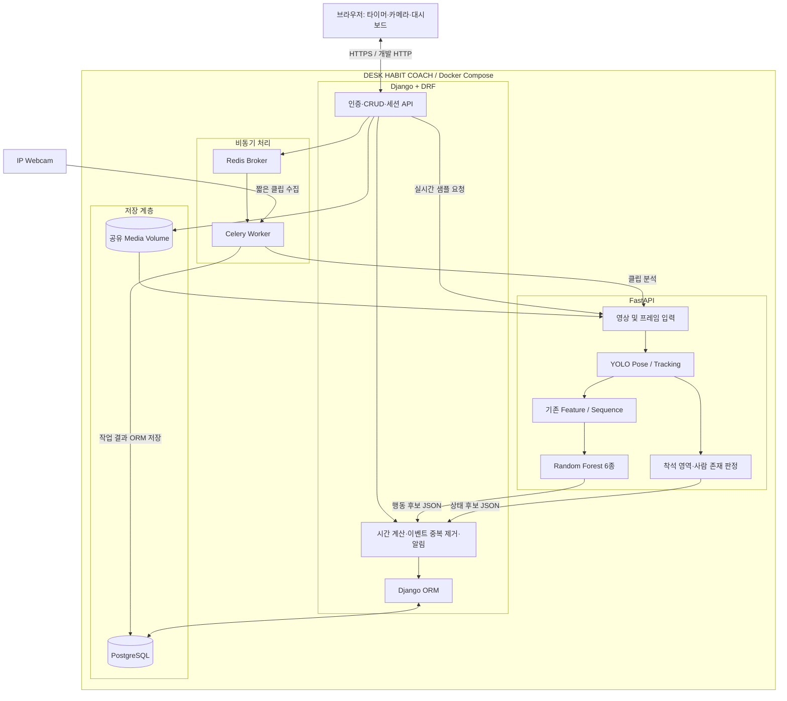
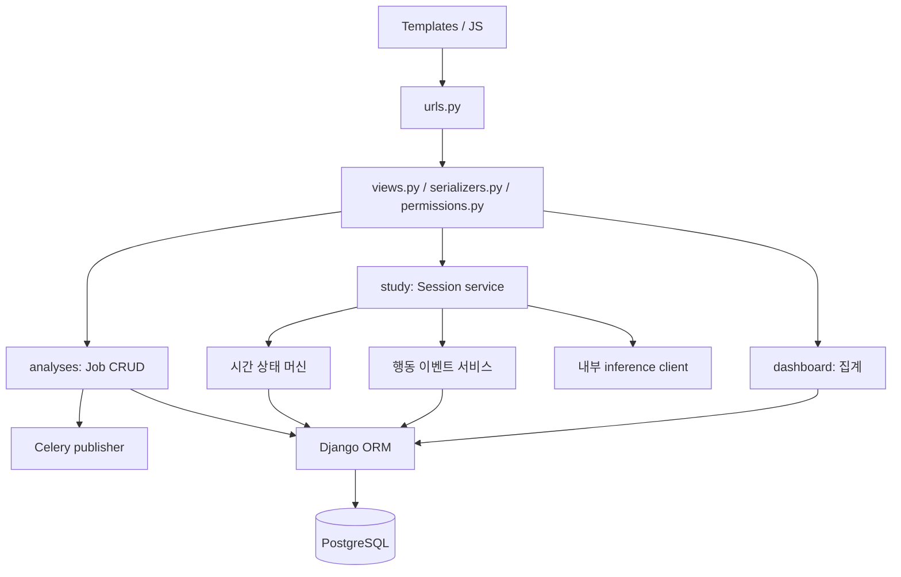
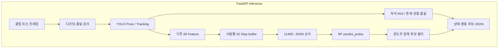
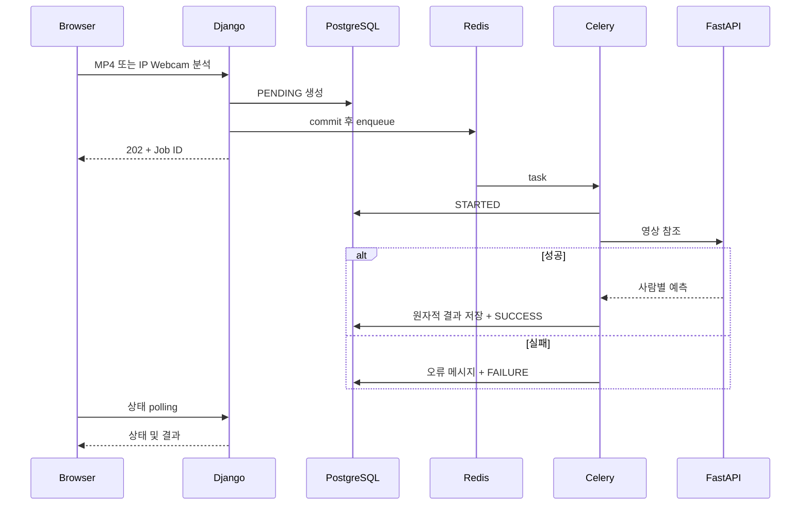
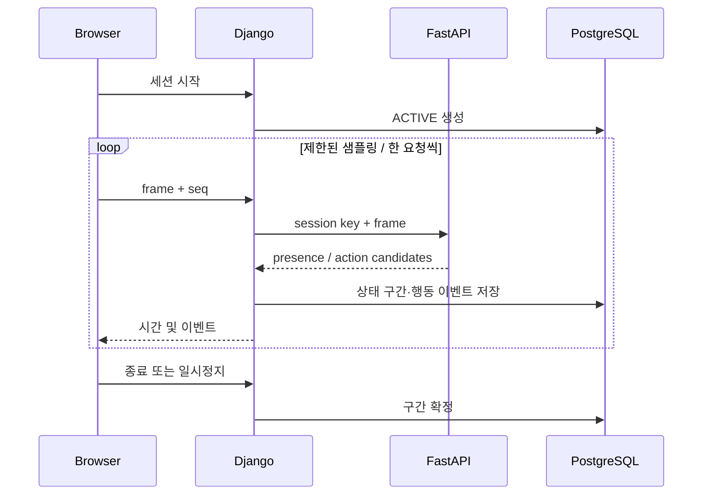
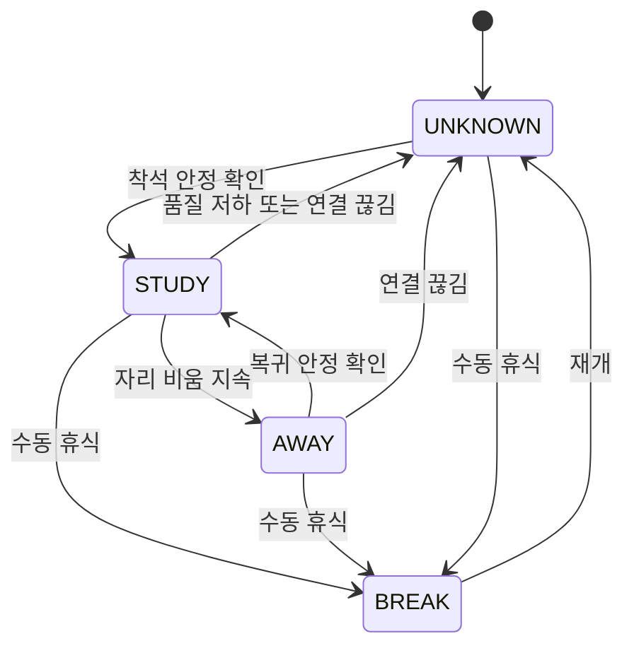
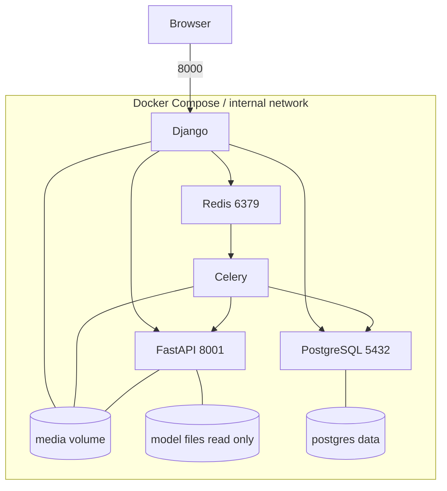

# 시스템 아키텍처 v2.0

## 전체 시스템 — Docker Compose 5개 서비스

위 결과 화살표는 논리적 흐름이다. 클립 결과는 FastAPI → Celery → ORM, 실시간 결과는 FastAPI → Django → ORM 경로로 반환한다. FastAPI는 DB에 직접 접근하지 않는다.

## Django 내부

## AI 추론 내부

클립과 실시간 입력의 tracker/buffer는 격리한다. 실시간 세션별 상태는 메모리 TTL로 관리하고 초기 배포는 FastAPI 단일 프로세스. 재시작 시 buffer 초기화 및 UNKNOWN 처리. 학습 당시 샘플링 간격을 유지할 수 없으면 행동 추론을 보류한다.

## 클립 비동기 시퀀스 (교과 필수)

## 실시간 세션 시퀀스

브라우저 getUserMedia는 명시적 시작 후만 활성화. 초기에는 HTTP 샘플 전송, 동시 요청 1개, 크기·빈도 제한, timeout. 실시간 경로는 Celery 장기 작업으로 만들지 않는다. HTTPS 또는 localhost 필요. 프레임 원본은 기본 미저장. 연결 끊김은 UNKNOWN, 사용자 종료 시 카메라 track stop.

## 시간 상태 머신

STUDY는 착석 기반 추정이며 실제 집중 측정 아님. 수동 휴식 우선, 종료는 모든 상태에서 가능. 상태 구간은 겹치지 않으며 서버 시간 기준으로 계산한다.

## 배포

Django만 외부 공개. IP Webcam은 Worker가 허용된 주소로 접속. 모델·DB·Redis 포트는 내부 전용. GPU/CPU 자원 및 동시 추론 제한을 측정한다.
