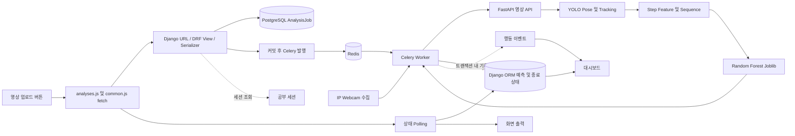

# Desk Habit Coach 코드 구조 분석 및 리팩토링 계획

2026-11-25 · 코드 검토 및 기준선 측정 · 구현 승인 대기

## 1. AS-IS와 독립 실행 판단

**교과 10의 구조를 따르는 업로드 영상 분류 경로는 존재한다.** FastAPI의 영상 추론은 Django·공부 세션·습관 기록·대시보드 없이 직접 호출할 수 있다. 현재 제공되는 기본 모델은 자체 학습 4종 `service`다. 원 교과 6종 `course`용 로더 분기는 있으나 해당 디렉터리에 README만 있어 원 교과 모델 실행은 미검증이다. FastAPI 프로세스 자체는 시작 시 전화기 탐지 가중치와 실시간 버퍼도 초기화한다. Django 업로드는 **공부 세션을 사용하지 않는 사용자**도 실행 가능한 구조다. 다만 전체 앱에서 공부·습관·대시보드 의존성을 제거한 상태의 실행은 지원하는 경계가 없다. [기본 모델 설명](../README.md#L5) · [course 준비 상태](../ai_service/models/course/README.md) · [FastAPI 초기화](../ai_service/main.py#L15)

- [list.html:15](../backend/templates/analyses/list.html#L15)의 폼 제출 → [analyses.js:130](../backend/static/js/analyses.js#L130) multipart POST → [common.js:7](../backend/static/js/common.js#L7) fetch 및 CSRF → [config/urls.py:10](../backend/config/urls.py#L10) → [analyses/urls.py:6](../backend/analyses/urls.py#L6) DRF 라우터 → [AnalysisJobViewSet.create](../backend/analyses/views.py#L45) → [AnalysisJobSerializer.validate](../backend/analyses/serializers.py#L73) → 파일 및 사용자별 작업 저장. 허용 외 확장자도 202와 실패 작업을 반환한다. 정상 요청은 커밋 후 큐에 발행한다.
- [tasks.py:25](../backend/analyses/tasks.py#L25)의 워커가 PENDING을 조건부 STARTED로 선점 → [services.py:19](../backend/analyses/services.py#L19)가 공유 미디어의 파일을 FastAPI로 전송 → [predictions.py:132](../ai_service/routers/predictions.py#L132)가 임시 파일에 쓰고 `track_people` → `step_features` → `predict_people` → `windows`, `active_windows`, RF Window 확률 평균. 예측 유효성 검증 후 Django가 `bulk_create`와 상태 전이를 수행한다. NO_PERSON/NO_VALID_WINDOW는 빈 결과의 SUCCESS이고, 잘못된 영상·너무 짧은 영상은 실패 경로다.
- [analyses.js:50](../backend/static/js/analyses.js#L50)의 GET `/api/analyses/<id>/status/`는 진행 중 2초, 404 외 실패 시 4초 간격이다. 사용자 필터와 예측·이벤트 prefetch를 거쳐 사람이 읽을 표와 기존 기록 사유를 표시한다. [views.py:42](../backend/analyses/views.py#L42) · [serializers.py:47](../backend/analyses/serializers.py#L47)
- Django 전체의 결합 근거는 생성 시 `open_session`, 작업 완료 시 `record_from_job`, 상태 출력 시 `job.events`, 모델의 세션 FK, 공통 템플릿의 대시보드·공부 URL, 사용자 방문 추적 미들웨어다. 습관 기록 예외가 현재 결과 트랜잭션 전체를 롤백한다. 동일 Compose 안에서 업로드 활동이 확장 기능의 실행 성공에 좌우되지 않는 경계가 필요하다. [models.py:7](../backend/analyses/models.py#L7) · [tasks.py:48](../backend/analyses/tasks.py#L48) · [base.html](../backend/templates/base.html) · [activity.py:29](../backend/dashboard/activity.py#L29)

## 2. 확장 파이프라인

| 확장 | 호출 흐름과 재사용 경계 |
| --- | --- |
| IP Webcam | 분석 폼의 카메라 선택 → Django `camera_stream` 및 `hub_for` → MJPEG 미리보기. 워커 `_capture_into` → 서명 토큰을 사용하는 같은 중계 → `capture`로 MP4 확보 → 업로드와 동일한 `predict_video` 이후 경로. [page_views.py](../backend/analyses/page_views.py) · [camera_hub.py](../backend/analyses/camera_hub.py) · [camera_capture.py](../backend/analyses/camera_capture.py) |
| 실시간 웹 카메라 | 브라우저 `getUserMedia` → `sendFrame` JPEG/seq → `StudySessionViewSet.frames` → FastAPI `/predict/frame` → Pose predict, ROI, StreamBuffers, RF 후보 → 상태·이벤트 적용 → 관절 오버레이. Pose 가중치·Feature·Window 규격·RF 번들을 공유한다. [study.js:137](../backend/static/js/study.js#L137) · [study/views.py:86](../backend/study/views.py#L86) · [predictions.py:76](../ai_service/routers/predictions.py#L76) |
| 공부·휴식 | 수동 버튼 및 heartbeat, 또는 프레임 `classify → observe` → 세션 및 구간 잠금·정산 → Serializer 집계 → 화면. 복귀 확인과 BREAK/AWAY 정산은 착석 관측 기반이다. [time_engine.py:115](../backend/study/services/time_engine.py#L115) · [time_engine.py:204](../backend/study/services/time_engine.py#L204) |
| 음료·움직임 | 클립 `record_from_job`과 실시간 `record_realtime_decision`이 공통 라벨 맵·그룹 점수·Threshold를 사용한다. 클립 작업당 1건, 실시간 episode 및 cooldown, 소스 간 근접 중복 제외를 각각 적용한다. [habits.py](../backend/analyses/habits.py) · [event_service.py](../backend/study/services/event_service.py) |
| 휴대폰 | `detect_phone`일 때 별도 YOLO 검출 모델을 호출하여 COCO 67, conf 0.35로 검출한다. Django `observe`에서 활성 세션의 지속 관측을 기록·알림으로 전환한다. [predictions.py:90](../ai_service/routers/predictions.py#L90) · [time_engine.py:248](../backend/study/services/time_engine.py#L248) |
| 사용자·관리 통계 | 대시보드가 AnalysisJob·PersonPrediction·BehaviorEvent·StudyInterval을 읽고, 일별 방문·로그인은 DailyUserActivity로 수집한다. 사용자 페이지와 staff 화면은 Django에서 렌더링하며 표·타임라인·정정 버튼을 페이지별 JS가 연결한다. [dashboard/views.py](../backend/dashboard/views.py) · [usage.py](../backend/dashboard/usage.py) · [activity.py](../backend/dashboard/activity.py) |

## 3. 폴더·파일 책임 및 호출 관계

아래는 런타임과 학습 소스 인벤토리다. 반복되는 패키지 초기화 및 마이그레이션은 디렉터리 단위로 묶었다.

| 경로 | 책임과 주요 호출 |
| --- | --- |
| 루트 `compose.yaml`, `compose.dev.yaml`, `.env.example`, README | 배포 및 개발 서비스 연결, 환경 계약, 실행 가이드. Django 1 프로세스/16 스레드, 워커 concurrency 2, FastAPI 1 프로세스. PostgreSQL 데이터와 공유 미디어 볼륨. [Compose](../compose.yaml#L31) |
| `ai_service/main.py`, Dockerfile, requirements | FastAPI 수명주기, 모델·버퍼 초기화, health, 가중치 제공 및 의존성 고정. |
| `ai_service/services/model_loader.py` | `load_bundle → joblib.load / feature_columns` 및 클래스·순서·차원·fps·stride 검증. `ModelBundle`은 모델/프로필/학습 메타데이터 제공. |
| `ai_service/routers/predictions.py` | `internal_auth`, 업로드 크기/디코딩/ROI 검증, `presence`, 영상·프레임 응답 포맷, 버퍼 삭제. |
| `ai_service/services/pose_pipeline.py` | `probe → track_people`, YOLO 모델 잠금 아래 영상 스트리밍, track별 희소 Step을 결측 포함 배열로 변환. |
| `ai_service/services/action_inference.py` | `predict_people → windows → active_windows → predict_proba`, 사람별 확률 평균·반올림·Track ID 재매핑. |
| `ai_service/services/stream_buffer.py` | `StreamBuffers.add → _purge / windows`; 키별 슬롯·TTL·결측·stride·최대 스트림 수, `drop` 및 health 개수. |
| `ai_service/src/feature_utils.py`, `sequence_utils.py` | `step_features → _angle`, `feature_columns`, `windows`, `active_windows → window_motion`. 학습·서빙 계약의 원본. |
| `ai_service/models/{service,course}`, `ai_service/tests/test_api.py` | 프로필별 모델 산출물 또는 준비 안내, API·모델·버퍼 검증. |
| `backend/config`, manage.py, Dockerfile, requirements | settings의 DB/인증/미들웨어/AI·Celery 구성, URL 조립, WSGI/ASGI 및 Celery 자동 탐색, 관리 명령과 런타임 이미지. |
| `backend/accounts/{views,urls,tests}.py`, accounts·registration templates | Django 인증/가입 화면과 테스트. |
| `backend/analyses/{urls,views,page_views}.py` | API 라우터, 작업 CRUD·큐 발행·상태, 목록/상세 페이지, 허용 카메라 중계 및 서명 확인. |
| `backend/analyses/{serializers,models,admin}.py` | 업로드/IPCAM 검증 및 DTO, 작업/사람 예측 ORM·관리 UI. |
| `backend/analyses/{services,tasks}.py` | 추론 HTTP 클라이언트 및 오류 번역. `analyze_job → _capture_into / predict_video → _finish / record_from_job`, `fail_stale_jobs` 및 worker-ready 훅. |
| `backend/analyses/{camera_capture,camera_hub,habits}.py` 및 templatetags | 카메라 영상 파일화, 공유 MJPEG 수신 및 중계, 확률→행동 그룹·표시명과 Django 템플릿 라벨. |
| `backend/study/{urls,views,serializers,models,admin}.py` | 세션/이벤트 API와 화면, 세션+구간 상태/집계/폰 횟수 JSON, 세션·구간·이벤트 ORM 및 관리 UI. |
| `backend/study/services/{time_engine,event_service}.py` | 상태 전이·관측·집계 및 이벤트 판정·중복 제한. `observe → _locked / _settle_gap / _switch`; 집계 함수들은 `_segments` 재사용. |
| `backend/dashboard/{views,urls,activity,usage,models}.py` | 오늘/주간/리포트/staff, 접근 추적·로그인 신호, 사용량 집계·페이지네이션, DailyUserActivity ORM. `apps.py`가 로그인 신호 연결. |
| `backend/templates`, `backend/static` | 공통 레이아웃/JSON 설정, 분석·공부·오늘·기록·관리 화면, `app.css`, `common.js`와 화면별 `analyses/study/today/reports/dashboard.js`. |
| Django 각 앱의 `tests.py`, `apps.py`, `migrations/`, `__init__.py` | 앱 초기화, 회귀 검증, DB 변경 이력 및 패키지 경계. |
| `training/{check_pose,train_rf}.py`, `data/`, `out/`, `out_check.txt`, `docs/` | 데이터 점검과 학습·평가, 로컬 원본·캐시·미리보기·로그, 설계/운영 문서 및 이미지. 서비스 기동 경로와 학습 실행 경로는 분리되어 있으며 학습은 서비스 전처리를 import한다. |

## 4. 확인된 문제와 우선순위

P0는 정확성·권한·핵심 완료 경계, P1은 반복 장애·구조 개선 또는 측정 근거가 있는 비용, P2는 추가 측정과 동등성 검증 뒤의 최적화다. 아래의 동시 실행 결과는 코드 경로상 위험으로 표시했으며 운영 장애 빈도는 미측정이다.

| ID / 우선순위 / 유형 | 코드 근거와 영향 |
| --- | --- |
| S1 / P0 / 구조 | 업로드 등록은 `open_session`, 완료는 `record_from_job`을 직접 호출한다. 단순히 세션을 사용하지 않아도 DB 조회와 기록 호출 경로는 실행된다. 결과가 확장 기록 실패로 롤백되는 정책은 변경 시 승인할 동작 경계다. [views.py:45](../backend/analyses/views.py#L45) · [tasks.py:48](../backend/analyses/tasks.py#L48) |
| S2 / P0 / 구조 | pause/end는 사용자 소유 확인보다 먼저 `drop_stream(pk)`를 실행한다. mode는 소유 확인 후 삭제하지만 상태 변경 성공 전이다. 소유 확인과 유효 상태 전이를 선행시키고 버퍼 삭제를 성공한 변경에 연결한다. [study/views.py:51](../backend/study/views.py#L51) |
| S3 / P0 / 구조 | 선점은 조건부 UPDATE, 결과는 원자적 저장으로 순차 중복 처리 방지. 반면 `enqueue` 실패 갱신과 `_finish`는 현재 상태·소유 task ID 조건이 없고 `_finish`는 모든 모델 필드를 저장한다. 늦은 완료가 복구 상태를 덮거나 동시에 수정된 제목·메모를 되돌릴 수 있다. 커밋 직후 발행 전 종료·선점 전 유실 시 오래된 PENDING 복구 경로도 없다. [views.py:25](../backend/analyses/views.py#L25) · [tasks.py:25](../backend/analyses/tasks.py#L25) · [tasks.py:67](../backend/analyses/tasks.py#L67) · [tasks.py:100](../backend/analyses/tasks.py#L100) |
| S4 / P1 / 구조 | HTTP 응답 변환은 영상/프레임마다 다르다. 영상 413/422의 `detail`은 dict라는 가정, 프레임은 성공 JSON 검증 부재, 오류 JSON은 422 검증 오류의 list를 처리하지 못한다. 이런 응답은 정의된 `AnalysisError` 경로를 벗어날 수 있다. [services.py:19](../backend/analyses/services.py#L19) · [services.py:56](../backend/analyses/services.py#L56) |
| S5 / P1 / 구조 | 실시간 View가 입력 검증부터 추론·폰 최대값·관측·이벤트·로깅·응답까지 담당한다. 관측과 RF 이벤트가 별도 트랜잭션에서 세션을 다시 잠그며 두 작업 사이 모드 전환 또는 더 최신 관측이 가능하다. 소스 간 cooldown도 SELECT 후 INSERT라 동시에 진입하면 작업별 고유 키만으로 교차 소스 중복을 막을 수 없다. 실제 교차 경합은 PostgreSQL에서 재현해야 한다. [study/views.py:86](../backend/study/views.py#L86) · [time_engine.py:213](../backend/study/services/time_engine.py#L213) · [event_service.py:22](../backend/study/services/event_service.py#L22) |
| S6 / P1 / 구조 | 분석 페이지는 이전 polling 타이머를 지워도 이미 진행 중인 GET이 응답하면 화면을 덮고 이전 작업 타이머를 다시 예약할 수 있다. 공부 페이지의 늦은 프레임 방어는 세션 UUID·stream 존재만 비교하므로 같은 세션 내 카메라 재시작/상태 변경까지 구별하지 않는다. `sendFrame`이 JPEG 인코딩 후 현재 `session`에서 URL을 다시 읽는 점도 경합 요인이다. [analyses.js:50](../backend/static/js/analyses.js#L50) · [study.js:203](../backend/static/js/study.js#L203) |
| S7 / P1 / 구조 | 프레임 RF가 HTTP 라우터 내부에 있고, 휴대폰 모델이 영상 전용 기동에서도 필수다. 별도 호출 흐름과 표시 계약에 맞는 추론 함수로 옮기고 전화기 모델 초기화를 선택 기능 경계로 이동한다. [predictions.py:112](../ai_service/routers/predictions.py#L112) · [main.py:22](../ai_service/main.py#L22) |
| S8 / P2 / 구조 | `record_realtime` 래퍼는 repo 검색상 테스트만 사용한다. vulture 90% 이상에서 나온 `record_login.sender`는 Django 로그인 signal 인자다. `StreamBuffers.__len__`는 `health`의 `len()` 호출이 있고, 학습 스크립트·정적 자산·장고 등록 코드는 동적 진입점이 있다. 확인된 삭제 대상 파일은 없다. [event_service.py:66](../backend/study/services/event_service.py#L66) · [activity.py:20](../backend/dashboard/activity.py#L20) |
| F1 / P1 / 성능 | 영상 generator 순회와 Feature 계산 전체가 Pose Lock 구간이며 프레임의 Pose와 별도 phone detector까지 같은 Lock 사용. 영상·실시간 경합과 메모리 비용을 먼저 측정한다. Lock 제거 또는 uvicorn worker 증설은 tracker 및 프로세스 로컬 버퍼 동작에 영향을 준다. [pose_pipeline.py:27](../ai_service/services/pose_pipeline.py#L27) · [predictions.py:93](../ai_service/routers/predictions.py#L93) |
| F2 / P1 / 성능 | 모든 polling에 전체 STARTED 만료 UPDATE가 붙고 중간 상태도 예측·이벤트 prefetch를 수행한다. 기존 status 인덱스가 있으므로 쿼리 실행계획과 실제 행 분포 확인 뒤 복합/부분 인덱스를 판단한다. [views.py:75](../backend/analyses/views.py#L75) · [tasks.py:70](../backend/analyses/tasks.py#L70) · [models.py:32](../backend/analyses/models.py#L32) |
| F3 / P1 / 성능 | 프레임마다 세션+intervals 선조회 후 행 잠금과 구간 재조회, 다시 prefetch 후 전체 intervals 반환, 폰 이벤트 count. Serializer가 현재 상태 2회, 누적 상태·출처별 초를 별도로 계산한다. 시간이 길고 구간이 많은 세션에서 반복 직렬화 비용을 측정한다. [study/views.py:35](../backend/study/views.py#L35) · [study/views.py:121](../backend/study/views.py#L121) · [study/serializers.py:27](../backend/study/serializers.py#L27) |
| F4 / P2 / 성능 | 대시보드 주간 집계는 일별 `_day_summary` 반복, staff는 여러 count·aggregate, 세션 목록의 distractions는 건별 count. reports는 이미 날짜 그룹 집계와 prefetch를 사용한다. 일별 구간 절단과 보정 로직을 유지하며 그룹 집계와 annotate를 부하 측정 후 선택한다. [dashboard/views.py:34](../backend/dashboard/views.py#L34) · [dashboard/views.py:169](../backend/dashboard/views.py#L169) · [dashboard/views.py:230](../backend/dashboard/views.py#L230) · [study/serializers.py:47](../backend/study/serializers.py#L47) |
| F5 / P2 / 성능 | 영상은 사람별 RF 호출, `ModelBundle.classes`는 접근 시 매번 문자열 리스트 생성, Django 영상 HTTP는 requests multipart 전송. 사람 수별 RF 병합이나 연결 재사용·메모리 최적화는 RF latency, CPU/RSS와 요청 풀 상태를 분리 측정한 뒤 적용을 판단한다. [action_inference.py:12](../ai_service/services/action_inference.py#L12) · [model_loader.py:35](../ai_service/services/model_loader.py#L35) · [services.py:19](../backend/analyses/services.py#L19) |

## 5. 중복 및 판정 동등성

| 중복 / 우선순위 | 통합 범위와 보존할 차이 |
| --- | --- |
| HTTP POST/timeout/연결 오류 / S4 P1 | 인증 헤더, 전송, JSON 및 오류 형태 방어 공통화. 영상 timeout (5, 설정값), 프레임 (2, 10), 삭제 (1, 2) 및 기존 정상·오류 메시지 매핑 유지. DELETE는 best effort. |
| RF 확률 호출과 라벨 매핑 / S7 P1 | 모델 입력과 클래스 순서 공통, 영상은 Window별 확률의 평균 뒤 반올림 및 argmax, 실시간은 단일 Window의 확률을 반올림한 뒤 내림차순 정렬. 동률 처리와 전체 확률 유지. |
| 그룹 점수·최고 라벨·Threshold / S5 P1 | `top_event`/라벨/Threshold 판단을 순수 함수에서 공유. 영상은 단일 유효 예측과 대표 라벨, 실시간은 후보 순위와 episode/cooldown을 사용한다. `study.js:224`는 MOVEMENT의 표시 라벨만 재계산한다. 기존 API에 기록 라벨 필드 추가 없이 현재 매핑과 wave 동률 우선을 fixture로 고정한다. `get_record`의 마지막 문구는 근접 중복 보류도 저점수로 나타낼 수 있다. 문구·응답 보존을 위해 진단 사유를 내부에서 먼저 구분한다. [serializers.py:47](../backend/analyses/serializers.py#L47) |
| ROI·업로드 크기·프레임 주기·관측 timeout / S4·S6 P1 | Django와 FastAPI의 검증은 HTTP 경계별 방어라 유지한다. 프레임 크기/ROI/6fps 계약을 양측 테스트로 고정한다. 브라우저 5초는 독립 상수이고 Django timeout은 설정값이다. 설정 변경 시 차이를 테스트하고 서버 설정을 전달해야 한다면 기존 API가 아닌 템플릿 JSON으로 전달할지 별도 승인한다. [study.js:7](../backend/static/js/study.js#L7) · [study.js:25](../backend/static/js/study.js#L25) · [settings.py:137](../backend/config/settings.py#L137) |
| 시간 집계 / F3·F4 P1/P2 | `current_state` 두 호출을 한 요청 스냅샷으로 계산하고 반복 구간 순회를 줄인다. 기존 열린 구간의 stale 정산과 경계별 초 단위 절삭 유지. |
| 점검 스크립트 sampling / S8 P2 | `check_pose.py:20,58`의 6fps/stride 계산과 서비스 `track_people`의 동등성을 문서화한다. 데이터 품질 검사 기준과 추론 정책은 독립적으로 보존한다. |

**Feature/Sequence 계약.** 공통 COCO 17점, 어깨 중심·너비 정규화, 관절 confidence 0.3, 38개 Step Feature, 6fps 목표, 30 Step, stride 6, 1,140개 순서, 50% 유효 Step, 결측 시 첫 유효값 및 직전 유효값 유지, float32를 고정한다. 영상은 입력 FPS의 정수 stride 및 Tracker ID로 샘플링하고 클립 최대 움직임의 상대 기준으로 Window를 고른다. 실시간은 seq 시각 슬롯과 ROI의 단일 대상, 큰 gap·다인 reset, 단일 Window를 사용한다. 실시간 착석 품질은 코·어깨 평균 0.5이고 RF Feature 유효 기준과 목적이 다르다. 현재 sampling·대상·집계·반올림 차이 때문에 같은 장면에 동일 결과를 기대할 근거는 없다. 동일 Feature 열과 슬롯에서 동일 Window 벡터를 만드는 쪽을 검증한다. [feature_utils.py](../ai_service/src/feature_utils.py) · [sequence_utils.py](../ai_service/src/sequence_utils.py) · [stream_buffer.py:53](../ai_service/services/stream_buffer.py#L53) · [predictions.py:50](../ai_service/routers/predictions.py#L50)

## 6. 의존성 분석

- Python 경로는 `analyses.views → tasks → study.event_service → analyses.habits`와 `study.views → analyses.services`로 앱 사이 양방향이다. 끝단 정책 모듈에 역방향 import가 없어서 현재 추적 경로에서 import cycle은 확인되지 않았다. `tasks._capture_into`의 지연 import는 워커가 페이지 모듈의 토큰 함수에 의존함을 보여준다. 토큰 유틸을 카메라 도메인에 두면 뷰와 워커가 같은 계약을 참조할 수 있다.
- DB는 `AnalysisJob → StudySession` nullable FK, `BehaviorEvent → AnalysisJob/StudySession`, `PersonPrediction → AnalysisJob` 관계다. 앱 설치 상태와 DB 계약은 유지하고, 흐름의 의존성을 먼저 해소한다. 삭제 CASCADE와 일반 사용자/관리자 범위를 회귀 검증한다.
- 대시보드의 읽기 의존성과 공유 레이아웃 URL 역참조는 현재 배포의 조립부에 남긴다. 방문 추적은 업로드 API 및 화면의 요청 성공 후 실행되지만 polling/frames에는 적용되지 않는다. 통합 배포에서 스택 자체를 제거하려면 URL/템플릿과 마이그레이션 별도 검토가 필요하다. 이번 제안의 독립성 단위는 **업로드 유스케이스와 FastAPI 영상 경로**다. [config/settings.py](../backend/config/settings.py) · [activity.py:10](../backend/dashboard/activity.py#L10)

## 7. TO-BE와 보존 계약

- Django View/Serializer는 요청·소유 확인·응답 변환을 담당하고, 작업 애플리케이션 서비스가 파일/작업 등록·큐 발행·조건부 상태 전이를 담당한다. 기존 Django 앱 조립부에서 세션 연결과 습관 기록 부수효과를 명시적으로 연결한다. 확장 연결을 생략한 업로드 서비스에서는 작업 제출·분석·조회가 성공하도록 검증한다.
- 정상 통합 모드에서 습관 이벤트와 완료 표시 순서를 유지한다. 장애에서도 core SUCCESS를 보존하는 정책은 P0 구현 전 명시 승인 대상이다. 승인 후 확장 기록을 내부 savepoint에 두고 예외를 분리하는 방식을 우선 비교한다. 이 방식은 core와 초기 기록을 동일 커밋에서 공개하며, 이벤트 실패 진단과 재처리는 고유 job 키를 통해 설계한다. 승인 전에는 기존 SAVE_ERROR 원자성 동작을 동결한다.
- FastAPI 영상 파이프라인은 파일·Pose/Tracking·공유 전처리·RF 번들만 사용한다. 실시간은 프레임 입력·ROI/관측·버퍼·선택 검출기를 사용하고 공통 RF 확률 계산을 호출한다. 라우터는 검증과 직렬화 담당이며, 모델 수명·동시성은 AI 서비스에서 관리한다.
- 기존 화면·조작·URL·상태 코드·응답 키/형식과 DB 데이터, 세션/권한, 파일 정리, 모델 산출물·Threshold·Feature/Sequence, Docker 구성과 라이브러리를 유지한다. 순차적으로 적용하고 각 단계에서 기존 계약 스냅샷과 비교한다.

## 8. 수정·추가·삭제 예정 파일 및 방법

| 변경 / ID | 파일 | 구현 방향 |
| --- | --- | --- |
| 수정·추가 / S1 S3 P0 | `backend/analyses/views.py`, `tasks.py`, 신규 `job_service.py` | 등록·발행·종료를 서비스에 배치. on_commit 유지, 확장 호출은 조립부에서 전달. 상태·task ID 조건부 종료와 결과 반영 원자성, 좁은 필드 갱신. PENDING 만료는 발행 지연/대기 기준을 먼저 정의하고 기존 운영 복구 진입점으로 묶는다. 재발행은 전달 여부가 불명인 경우의 멱등 동작 검증 뒤 고려. |
| 수정·추가 / S2 S5 P0/P1 | `backend/study/views.py`, 신규 `services/frame_service.py`, `services/time_engine.py`, `services/event_service.py` | 소유·상태 확인 후 버퍼 삭제. AI HTTP는 DB 잠금 밖에 두고 결과 반영 시 seq·mode·status를 재검증. 관측·이벤트 저장 경계를 한곳에서 조정한다. 교차 소스 중복은 PostgreSQL 재현 후 사용자 단위 공통 잠금 등 최소 변경을 평가한다. |
| 수정 / S4 P1 | `backend/analyses/services.py` | 기존 호출자 시그니처 유지, 공통 전송/오류 해석, 영상·프레임 성공 응답 각각 검증. 정상 413/422/401 및 기존 503 매핑 회귀. |
| 수정 / S5 P1 | `backend/analyses/habits.py`, `serializers.py` | 단일 사람 대표 결과·Threshold 평가를 공통 함수로 정리, 표시용 점수 재계산 축소, 구 데이터의 빈 profile 및 교과 프로필 처리 유지. |
| 수정·추가 / S1 P0 | `backend/analyses/{tasks,page_views}.py`, 신규 `camera_relay.py` | 중계 토큰 생성/검증을 페이지에서 추출. 기존 URL/토큰 규약·카메라 허용 목록·미리보기 공유 유지. |
| 수정 / S7 F1 F5 P1/P2 | `ai_service/{main.py,routers/predictions.py,services/action_inference.py,services/model_loader.py,services/pose_pipeline.py,services/stream_buffer.py}` | 영상과 프레임 RF 공통 계산, 버퍼별 메타데이터·결측/TTL 유지. 휴대폰 모델 초기화는 선택 검출 경계로 이동하고 첫 요청 준비·실패를 검증한다. Lock 소유권을 Pose 서비스에 캡슐화하고 대기/실행 구간을 측정한다. phone 전용 Lock과 임계 구간 축소는 Tracker 동등성 및 CPU/RSS 확인 후 적용한다. 클래스 순서 캐시는 측정 후 판단. |
| 수정 / F2 F3 F4 P1/P2 | `backend/analyses/views.py`, `backend/study/{views,serializers,services/time_engine}.py`, `backend/dashboard/{views,usage}.py` | 상태별 prefetch·직렬화, 전역 stale 정리의 호출 빈도 제어와 조회 시 만료 응답 보존, 같은 시각을 쓰는 세션 스냅샷, 구간 조회·폰 count 통합. 대시보드 쿼리는 PostgreSQL EXPLAIN 결과에 따라 수정 범위 확정. |
| 수정 / S6 P1 | `backend/static/js/{common,analyses,study}.js` | 공통 fetch/CSRF 보존. 분석 화면 작업 세대 및 AbortController로 이전 GET 무효화. 공부 화면에 요청 시점 세션·카메라 세대 고정, 모드 전이/탭 종료 시 폐기 처리, 버튼·프레임 요청 간 경합 방지. |
| 수정·후속 판단 / S8 P2 | `backend/study/{services/event_service,tests}.py`, `training/check_pose.py` | 테스트 전용 래퍼의 호환성 확인 후 테스트를 실제 진입점으로 이동할지 판단. signal 인자, 동적 호출, 데이터 및 모델 파일 보존. 삭제 예정 파일 없음. |
| 수정 / P0–P2 해당 항목 | `backend/{analyses,study,dashboard}/tests.py`, `ai_service/tests/test_api.py` | 아래 회귀 시나리오를 기존 테스트에 추가한다. 실제 통합 시나리오는 기존 Compose의 격리된 테스트 DB/브로커에서 실행한다. |

## 9. 리팩토링 순서와 단계별 승인 기준

1. **P0 구조**. 응답, 권한, 기존 작업 전이, 모델 입력·출력 기준선을 고정한다. 권한 확인 순서 및 상태 가드를 먼저 보완하고 테스트에서 작업 중 제목 변경, Worker 재시작·늦은 결과, 큐 오류를 검증한다.
2. **P0 구조**. 작업 서비스와 카메라 경계를 추출한다. 확장 없이 업로드 성공 시험, 확장 연결 상태에서 세션 컬럼/기존 습관 기록과 CASCADE 시험을 각각 통과시킨다. 확장 실패 시 완료 정책은 별도 결정한다.
3. **P1 구조**. HTTP 오류 계약, RF 공통 처리, 프레임 응용 서비스 및 JS 응답 소유권을 작은 변경으로 진행한다. 입력·출력과 시간/행동 회귀를 각 변경에서 확인한다.
4. **P1 성능**. Lock·쿼리·직렬화 기준선을 운영 구성과 같은 격리 환경에서 수집한 뒤, 지표별 한 가지 변경씩 적용해 영향 범위를 확인한다. stale 정리는 기존 응답의 만료 시점을 보존하는지 확인한다.
5. **P2 구조/성능**. 대시보드와 RF 비용을 재측정해 확인된 비용에 한해 집계·RF 최적화와 정리를 진행한다. 인덱스·마이그레이션은 계획과 측정 근거가 있을 때 별도 승인한다.

## 10. 위험 및 회귀 테스트 계획

| 위험 / 우선순위 | 현재 보장과 추가 검증 |
| --- | --- |
| 작업 유실·중복·잘못된 상태 전이 / P0 | 기존 `analyses/tests.py:218`은 mock 추론으로 성공/실패/롤백/순차 중복/STARTED 복구 검증. 실제 Redis→Celery→FastAPI→PostgreSQL 왕복, 커밋 전 발행 금지, 이중 소비, 워커 종료, 늦은 결과, 제목 PATCH 경합, 링크 없는 업로드, 확장 실패 주입을 추가한다. |
| API·권한·데이터 회귀 / P0 | 기존 분석 API 대상을 본인으로 제한하고 파일 삭제·연쇄 동작을 테스트한다. 세션 pause/end 타인 ID에서 AI DELETE가 호출되지 않는지, 비인증·CSRF·staff·카메라 접근, 종료 후 캐시 응답, 구 데이터 빈 프로필 및 이벤트 정정 표시를 고정한다. |
| 모델/Threshold 변동 / P0/P1 | 기존 AI 테스트는 모델 계약, 단일/다인 관측, 짧은 영상·손상·빈 영상, TTL 및 누락 슬롯, 내부 인증을 포함한다. 고정 영상·프레임·track fixture의 정렬/동률/반올림 경계, 29/30 Step, half-valid, 미검출, Threshold 직전/동일/직후, service와 course 분리 검증을 추가한다. 원 교과 모델이 제공되면 별도로 실측한다. |
| 실시간 상태·이벤트 경합 / P1 | 기존 `study/tests.py`는 수동/자동·부재·복귀·중복 seq·폰/이벤트/episode 및 API를 검증한다. PostgreSQL 동시 동일/역순 seq, pause/end/모드 전환 중 늦은 프레임, 버퍼 삭제가 지연된 in-flight 응답, 클립/실시간 동시 기록, 자정/열린 구간, 5초 관측 timeout 정산을 추가한다. |
| 브라우저 상호작용 / P1 | 이전 polling 응답을 늦춰 새 결과·URL 유지 확인. 업로드/IPCAM 전환, 404/실패 재시도와 미리보기 복귀, 카메라 토글/정정/알림, 기존 모바일 화면과 문구를 실제 브라우저에서 확인한다. Django 템플릿 응답 테스트만으로 이벤트 경합은 검증되지 않는다. |
| 최적화 회귀 / P1/P2 | 단독 영상, 단독 프레임/폰, 동시 흐름에서 순서와 결과를 비교한다. 메모리·락 대기·구간 수 증가에 따른 SQL 및 응답 크기를 비교하고, 대시보드의 사용자 범위/시간대/정정 제외 결과를 기존 데이터 fixture와 비교한다. |

## 11. 성능 기준 및 현재 측정 결과

### 기준선과 비교 방법

| 계측 구간 | 측정 기준 및 비교 게이트 |
| --- | --- |
| 업로드 브라우저→결과 | 고정 5/10/30초 영상, 0/1/다인, 동일 해상도·코덱과 파일 크기. POST 202, enqueue→STARTED, STARTED→ORM 종료, 종료→첫 polling 렌더를 나눠 p50/p95·실패율·처리량 측정. polling 간격 2초는 서버 처리 시간과 별도 집계. |
| FastAPI 영상 | decode/탐색, Pose Lock 요청→획득/보유, 결과 Feature·Window, RF, 전체 latency 및 RSS. 워커 1·2 요청 동시 비교. 현재 FastAPI `processing_ms`와 Celery `processing_ms`는 측정 범위가 다르며 워커는 FastAPI 값으로 DB 필드를 채우지 않는다. |
| 실시간 | 동일 640px 폭 JPEG를 단독 및 영상과 혼합, phone off/on, 1/2/5 스트림에서 비교. p50/p95, 실제 전송/정상 관측 fps, gap/TTL 리셋 및 UNKNOWN 비율. 6fps의 프레임 주기 약 167ms는 참조 예산이며 브라우저는 이전 요청 진행 중 프레임을 건너뛴다. 5초 기본 관측 timeout은 상태 품질 지표에 별도 반영한다. |
| PostgreSQL/대시보드 | `CaptureQueriesContext` 또는 테스트용 SQL 로깅, status/frames/today/reports/staff별 쿼리 수·p95·응답 바이트. 세션 0/10/100 구간 및 대표 데이터 크기에서 `EXPLAIN (ANALYZE, BUFFERS)`로 인덱스 선택을 확인한다. 쓰기 쿼리 분석은 격리 DB에서 수행한다. CPU·메모리·DB 버퍼 및 데이터 분포를 함께 기록한다. |

비교 실행은 동일 머신·런타임·가중치·데이터셋·동시성에서 워밍업 후 진행한다. 프로덕션 유사 측정은 부하 조건당 프레임 120개 이상, 영상 30건 이상을 3회 반복하고 p50/p95, 오류율, 결과 동등성을 비교한다. 승인 후 실측 기준선에 맞춰 수치 목표를 확정한다. 성능 변경은 해당 구간 개선이 반복 측정에서 드러나며 다른 대표 조건의 오류율·출력 및 p95에 유의한 회귀가 없을 때 채택한다.

### 이번 검토의 로컬 관측값

| 항목 | 현재 결과 및 범위 |
| --- | --- |
| Django 전체 테스트 | SQLite 테스트 DB에서 95개 통과, 23.394초. `backend/`에서 `PYTHON_DOTENV_DISABLED=1 POSTGRES_DB= ../.venv/bin/python manage.py test --noinput`. 로컬 `.env`의 자동 로드를 끄고 실행한다. |
| 분석 status ORM | SQLite 메모리, 강제 인증 및 `APIRequestFactory` 사용. PENDING/빈 SUCCESS 각각 SQL 4문(UPDATE 1, SELECT 3). 사용자 인증·미들웨어 및 네트워크 시간 제외. UPDATE가 실제 행을 변경했는지는 이 측정에 포함하지 않았다. |
| 실시간 frames ORM | 같은 SQLite 조건, 구간 없는 AI 세션 및 mock FastAPI 응답에서 200과 SQL 11문(BEGIN/COMMIT 포함, SELECT 8, UPDATE 1). 실제 활성 구간, 실시간 행동 이벤트·폰 기록이 추가되면 다른 경로를 사용한다. |
| Compose/전체 경로 | Docker 소켓 접근 거부 및 기본 PostgreSQL 연결 실패로 PostgreSQL 실행계획, Redis 대기열, 실제 워커 왕복, 브라우저 polling·실제 웹캠 및 대시보드 부하는 미측정. SQLite에서는 PostgreSQL 행 잠금 경합을 검증할 수 없다. |
| FastAPI 테스트 | Feature, Sequence, 모델 계약, ROI/presence, 버퍼 대상 8개 통과, 1.48초. 전체 19개 중 HTTP fixture를 사용하는 테스트는 로컬 Starlette TestClient의 AnyIO portal 초기화 대기로 완료하지 못했다. 원인은 미확정이며 아래 직접 호출 측정은 HTTP 통합 검증을 대신하지 않는다. |
| FastAPI 프레임 단독 | 실제 service RF·YOLO, 640×480 JPEG, phone off 12회 중앙값 25ms / 최대 26ms. phone on 12회 중앙값 49.5ms / 최대 52ms. 단일 이미지에 대한 검출 비용이다. |
| FastAPI 영상 단독 | 실제 Pose Tracking·RF, 테스트의 bus.jpg 반복 MP4(6초·30fps), 3회 중앙값 1,232ms / 최대 1,262ms. 사람 예측이 생성된 경우만 비교했다. |
| FastAPI 영상과 프레임 혼합 | 영상 시작 약 250ms 후 별도 스레드에서 phone off 프레임 투입. 3회 프레임 1,031 / 974 / 989ms, 중앙값 989ms. 같은 회차 영상 1,279 / 1,214 / 1,225ms. Lock 대기 자체는 별도 계측하지 않았으며 이 소표본은 공유 모델 경합을 우선 계측할 근거다. |

직접 호출은 i7-12700 호스트의 로컬 Python 3.14 환경에서 `OMP_NUM_THREADS=1 MKL_NUM_THREADS=1 OPENBLAS_NUM_THREADS=1`로 실행했다. FastAPI lifespan에서 모델을 준비하고 각 단독 조건을 1회 워밍업한 뒤, 실제 라우터 함수에 메모리 UploadFile을 전달해 라우터의 `processing_ms`를 기록했다. HTTP/ASGI·Redis·DB·브라우저 지연과 콜드 스타트는 포함하지 않았다. 소표본이므로 p95는 제시하지 않는다.

## 12. 전체 프로젝트의 미사용 코드 및 간소화 검토

### 도구와 판정 기준

- Ruff 0.17.4는 로컬 캐시의 실행 파일로 `check --no-cache --select F401,F811,F821,F841,ARG001,ARG002,RUF059 ai_service backend training`을 실행했다. 결과는 테스트의 미사용 언패킹 2건, 미사용 콜백·오버라이드·테스트 대역 인자 23건이다. 실행한 규칙 범위에서 미사용 import, 재정의, 정의되지 않은 이름, 단순 미사용 지역 변수는 보고되지 않았다.
- Vulture 2.16을 세 Python 루트에서 신뢰도 60% 이상으로 실행해 182건을 얻었다. 90% 이상에서는 Django 로그인 signal의 `sender`만 보고됐다. 낮은 신뢰도 결과는 URL·데코레이터·모델/폼/시리얼라이저·테스트 등록 및 템플릿 사용과 대조했다. Ruff와 Vulture 모두 읽기 전용으로 실행했다.
- CSS는 클래스/ID 후보를 템플릿·JS·Python에서 교차 검색한 뒤 그룹 선택자와 동적 조합을 확인했다. JS는 `window.App` 내보내기, 객체 구조 분해, 이벤트 핸들러와 타이머, `json_script`, Chart.js 콜백·로드를 함께 확인했다. 런타임 렌더 결과 및 외부 소비자까지 계측한 결과는 아니므로 아래 정적 후보는 구현 단계에서 화면과 계약을 확인한다.
- 환경 설정은 예제 파일, Compose 치환, Dockerfile, Django·Celery 설정 로더, FastAPI 및 학습 진입점과 대조했다. 의존성은 가상환경의 로컬 패키지 메타데이터와 사용 위치로 확인했다. 로컬 `.env` 값은 검토 결과에 포함하지 않았다.

### 삭제·통합 후보

| ID / 우선순위 / 유형 | 파일·위치와 정리 근거 | 영향 범위 및 방법 |
| --- | --- | --- |
| C1 / P2 / 구조 | [test_api.py:97](../ai_service/tests/test_api.py#L97), [test_api.py:203](../ai_service/tests/test_api.py#L203)의 `cv2.imencode` 성공 여부 `ok`가 읽히지 않는다. Ruff RUF059. | 프레임 테스트 2건. 테스트 전제인 JPEG 인코딩 성공을 `assert ok`로 확인하거나 그 검증이 중복이면 `_`로 받는다. |
| C2 / P2 / 구조 | [event_service.py:66](../backend/study/services/event_service.py#L66)의 `record_realtime`은 `record_realtime_decision(...).event` 그대로 전달한다. 저장소의 호출 세 곳은 [study/tests.py:248](../backend/study/tests.py#L248) 및 [tests.py:384](../backend/study/tests.py#L384)에 있다. 프로덕션 View는 결정 함수 직접 호출. | 내부 Python 호출만 영향. 프로젝트 밖 Python 호출 계약 확인 후 해당 테스트를 결정 함수로 연결해 이벤트·보류 결과를 검사하고 래퍼 삭제. HTTP·정책 규격 유지. |
| C3 / P2 / 구조 | [page_views.py:15](../backend/analyses/page_views.py#L15)의 `_page_config`는 `job_list` 한 곳에서만 두 키짜리 템플릿 데이터를 만든다. | `job_list` 안에서 컨텍스트를 구성. `page-config` 키 및 허용 카메라 별칭만 노출하는 규칙 고정. |
| C4 / P2 / 구조 | [common.js:31](../backend/static/js/common.js#L31)의 `time`은 export만 되고 페이지별 JS·템플릿에서 소비되지 않는다. [today.js:91](../backend/static/js/today.js#L91), [reports.js:48](../backend/static/js/reports.js#L48)의 `formatTime`은 같은 표현식이다. | 저장소 외 정적 자산 소비 여부 확인 후 `App.time` 및 함수 삭제. 동일 시간 포맷은 별도 파일 없이 `common.js`에서 한 번 정의한다. 두 차트 tooltip/tick의 초·분 경계를 확인한다. 서버 렌더링의 `_duration`은 시간·분 표현이 다르므로 유지. |
| C5 / P2 / 구조 | [list.html:2](../backend/templates/analyses/list.html#L2)의 `action_labels` 로드가 이 자식 템플릿에서 직접 쓰이지 않는다. [list.html:20](../backend/templates/analyses/list.html#L20)의 `dz-text` 클래스 선택자 참조는 확인되지 않고 같은 값의 ID는 JS와 `aria-describedby`에 연결된다. | 자식의 불필요한 로드와 클래스 속성만 정리. `base.html`의 `action_names`, `static` 로드, ID·텍스트·접근성 연결은 보존. |
| C6 / P2 / 구조 | [app.css:36](../backend/static/css/app.css#L36)의 `.chips` 및 [app.css:40](../backend/static/css/app.css#L40)의 `.chip[aria-checked="true"]` 참조가 없음. [app.css:70](../backend/static/css/app.css#L70)의 `.recent/.recent-item`, [app.css:98](../backend/static/css/app.css#L98)의 `.page-head/.stats.tight/.card.narrow`, [app.css:107](../backend/static/css/app.css#L107)의 `.event-list` 계열, [app.css:131](../backend/static/css/app.css#L131)의 `.big`, [app.css:142](../backend/static/css/app.css#L142)의 `.stats.two`, [app.css:220](../backend/static/css/app.css#L220)의 `.sr-only`도 현재 마크업·동적 클래스에서 참조가 확인되지 않았다. | 입력 폼/기록/대시보드 스타일. 사용되는 `.tabs`, `.tabs button[aria-selected="true"]`, `.invalid`는 그룹에서 보존하고 후보 선택자만 제거. 주요 화면의 데스크톱·모바일, 파일 선택, 접근성·동적 상태와 폼 오류를 비교한다. |
| C7 / P2 / 구조 | [dashboard/views.py:248](../backend/dashboard/views.py#L248)의 `statuses`는 [study/tests.py:538](../backend/study/tests.py#L538)의 직접 컨텍스트 검증에만 쓰인다. staff 화면은 [staff.html:74](../backend/templates/dashboard/staff.html#L74)의 `segments`를 사용한다. `stats.users/recorded`는 같은 테스트의 541행에서도 사용한다. `stats.not_recorded`와 `actions[].label`은 템플릿·JS·테스트 소비가 확인되지 않는다. | staff 내부 컨텍스트. `statuses`를 제거하려면 먼저 테스트가 4개 DB 상태 분포와 UI용 집계(완료 분리, PENDING/STARTED 합산)를 각각 검증하도록 전환한다. `STATUS_ORDER`는 호출이 사라지면 함께 정리. 표시되는 `segments[].status`는 보존. `stats.users/recorded`도 테스트를 실제 사용량·차트 데이터로 옮길 경우에만 정리한다. |
| C8 / P1 / 구조 | [habits.py:59](../backend/analyses/habits.py#L59)에서 길이가 1일 때만 진행하므로 `for`, `best`, `best_score` 갱신은 일반화된 최댓값 탐색을 하지 않는다. [event_service.py:32](../backend/study/services/event_service.py#L32)의 클립 저장은 판정 뒤 다시 그룹 점수를 구한다. | 단일 예측과 조기 반환으로 정리하고 현재의 `score > 0.0`, Threshold 경계, OTHER·빈 profile·course를 보존. 그룹 평가 중복은 S5에서 진단 정보가 실제로 필요한 호출자에 맞춰 한 번 계산한다. 새 클래스는 추가하지 않는다. |
| C9 / P1 / 성능 | [dashboard/views.py:95](../backend/dashboard/views.py#L95)의 오늘 요약 시간은 오늘을 포함한 주간 루프 [105](../backend/dashboard/views.py#L105)에서 다시 조회한다. [102](../backend/dashboard/views.py#L102)의 마지막 기록 쿼리는 모든 이벤트 타입에 돌지만 템플릿은 DRINK/MOVEMENT만 표시한다. [64](../backend/dashboard/views.py#L64)의 눈금 계산은 같은 `pct(h)`를 조건과 결과에서 반복한다. | 오늘 페이지 컨텍스트에서 오늘의 `seconds[State.STUDY]` 재사용, 마지막 기록은 표시 타입만 대상으로 제안하고 그룹 집계는 실행계획으로 선택. 눈금은 읽기 쉬운 한 번의 루프로 계산. 날짜별 누적·목표·눈금의 반올림은 고정. today/weekly 공개 API의 이벤트 키는 유지. |
| C10 / P1 / 성능 | [dashboard/views.py:271](../backend/dashboard/views.py#L271)의 최근 20건은 predictions를 prefetch한 뒤 1번째 예측을 반복 참조한다. [staff.html:108](../backend/templates/dashboard/staff.html#L108)의 `r.job.events.all`은 prefetch하지 않아 렌더 시 작업별 조회가 생긴다. | 한 번 가져온 예측 객체를 재사용하고 `events`도 기존 최근 작업 쿼리의 prefetch에 포함. 최근 작업 0/1/20건, 다중 예측 및 결과 없는 작업에서 템플릿 렌더까지 SQL과 표시를 비교한다. |
| C11 / P1 / 성능 | [event_service.py:35](../backend/study/services/event_service.py#L35)는 `dedup_key` 선조회, [42](../backend/study/services/event_service.py#L42)는 다시 `get_or_create`한다. [time_engine.py:88](../backend/study/services/time_engine.py#L88)의 `_settle_gap` 뒤 `_current`를 다시 실행하는 경로가 [134](../backend/study/services/time_engine.py#L134), [192](../backend/study/services/time_engine.py#L192), [227](../backend/study/services/time_engine.py#L227)에 있다. | 선조회는 기존 이벤트 반환을 cooldown보다 우선하므로 보존이 기본이다. PostgreSQL에서 중복 쿼리 제거와 경쟁 시 반환 동등성을 증명할 때만 통합. 시간 엔진은 정산 후 현재 구간을 기존 함수 반환값으로 재사용하는 방식을 검토하며 새 상태 표현은 추가하지 않는다. |
| C12 / P2 / 구조 | [predictions.py:81](../ai_service/routers/predictions.py#L81)의 ‘30 Step이 찰 때마다’ 설명은 [stream_buffer.py:80](../ai_service/services/stream_buffer.py#L80)의 최초 30 Step·이후 stride 6 및 유효률 조건을 다 담지 않는다. [action_inference.py:26](../ai_service/services/action_inference.py#L26)의 ‘등장 순서’는 코드가 실제로 보장하는 정렬된 유효 tracker ID 기준 재번호와 다르다. [pose_pipeline.py:31](../ai_service/services/pose_pipeline.py#L31)의 프로세스 증설 안내는 메모리 버퍼를 둔 단일 프로세스 운영 조건을 빠뜨린다. | 코드 주석만 현재 동작에 맞춘다. 샘플링, ID, 락, 서비스 수 유지. |
| C13 / P2 / 구조 | [study.js:2](../backend/static/js/study.js#L2)의 문구는 서버 갱신과 UI 보간을 함께 설명하지만 [study.js:7](../backend/static/js/study.js#L7)의 6fps는 요청 상한에 가깝다. [study.js:214](../backend/static/js/study.js#L214)의 `Date.now()` 설명은 새로고침 시 시계 역행이 없다고 전제한다. [settings.py:132](../backend/config/settings.py#L132)의 학습 후보 Threshold 주석은 기본값 0.5가 정의된 위치와 인접한다. | 실시간 샘플링을 목표 주기로, seq를 밀리초 시각과 서버 중복 검사의 조합으로 명시. 학습 후보값과 설정 기본값을 주석에서 명확히 연결. 값·정책 변경 없음. |

### 동적 사용과 레거시 보존 판단

- **Django/DRF**. `AppConfig.ready`, URL `urlpatterns`, 등록된 admin 클래스·`has_add_permission(request, obj)`, 시리얼라이저의 `get_*`/검증 메서드·`Meta`, `create/destroy`와 action 인자는 프레임워크가 호출한다. [dashboard/apps.py](../backend/dashboard/apps.py)에서 등록한 로그인 signal은 `sender/request/user`를 이름으로 전달한다. Ruff가 잡은 인자 제거·이름 치환은 일괄 적용하지 않는다. `status_url`, 중첩 예측 스코어 필드, 기존 마이그레이션 및 구 데이터 빈 프로필 처리도 API·DB 호환 대상이다.
- **Celery/FastAPI/실행 진입점**. `config.__init__` export, `autodiscover_tasks`, `@shared_task`, `@worker_ready.connect`, FastAPI `@app.get` 및 라우터 decorator, ASGI/WSGI의 `application`은 동적 진입점이다. [compose.yaml:48](../compose.yaml#L48)의 healthcheck도 `/health` 사용 근거다. `pause/resume/end`는 짧은 함수지만 `_change`에 각각 다른 상태·메시지를 연결하는 API 진입점으로 유지한다.
- **템플릿과 정적 파일**. 현재 브라우저가 만드는 `.verdict.ok/.ng/.fail`, 드롭존 `.over/.has-file`, 분석 단계의 `.done/.now/.fail`, 오늘 화면의 `k-{{ item.kind }}` 계열은 문자열 검색만으로 삭제할 수 없다. `.errorlist`는 Django 폼 렌더링 결과다. 분석 상세 템플릿·JS 경로, staff 부분 템플릿, CDN 로드 및 차트 대체 표시를 보존한다. 실제 화면 조각 전체를 삭제할 근거는 확인되지 않았다.
- **설정과 패키지**. `REDIS_HOST_PORT`는 [compose.dev.yaml:9](../compose.dev.yaml#L9)에서, 동적 `CAMERA_<별칭>_URL`은 [settings.py:107](../backend/config/settings.py#L107)에서 사용한다. `CELERY_*`는 [config/celery.py](../backend/config/celery.py)의 Django namespace 로더가 읽고 `POSE_WEIGHTS/DETECT_WEIGHTS`는 [AI Dockerfile](../ai_service/Dockerfile)에서 공급한다. `redis` 명시적 핀과 Celery Redis extra는 전송 경로, `psycopg-binary`는 Psycopg 구현, `lap`은 Tracker 런타임 의존성이다. `python-multipart`는 FastAPI 업로드, `httpx`와 `pytest`는 AI 테스트, 백엔드 NumPy는 카메라 테스트 및 OpenCV 의존성이다. 의존성 선언 중복처럼 보이는 핀은 설치 결과를 바꾸므로 제거를 제안하지 않는다.
- **레거시 및 파일 경계**. course 프로필, SQLite 로컬 모드, 카메라/IPCAM와 업로드 경로, 빈 모델 프로필 처리, 대시보드의 과거 방문 데이터 보정은 현재 호환 경로다. 초기 산출물이 있는 `data/`, `out/`, 로그와 과거 마이그레이션은 런타임 import가 없다는 이유로 삭제하지 않는다. `camera_hub`와 `camera_capture`, 모델 로더와 전처리 파일, `time_engine`과 `event_service`는 호출자와 책임이 구분된다. 이번 정리 목록에서 삭제하거나 병합할 서비스 파일은 확인되지 않았다.

### 적용 순서와 검증

1. 승인 후 C1–C6, C12–C13 중 작은 변경부터 기존 파일 내부에서 적용한다. JS 공용 포맷은 `common.js`를 사용하고, 카메라 설정과 클립 판정은 기존 함수에서 정리한다.
2. C7–C11은 기존 계획의 S5·F2–F4와 함께 검증한다. 테스트가 소비하던 staff 통계는 관찰 가능한 화면과 집계 계약을 먼저 고정한다. 쿼리 개선은 SQL 수와 반환 데이터 동등성을 함께 확인한다.
3. 앞 절의 신규 파일 후보는 **독립적인 호출자 또는 잠금·트랜잭션 소유권을 분리할 필요가 확인될 때** 채택한다. 단일 호출 전달 또는 짧은 정책 추출은 기존 `services.py`, `event_service.py`, `camera_hub.py`, 해당 View 내 코드로 우선 해결한다. 정리 전용 패키지·기반 클래스·의존성 도입은 계획에 없다.
4. 변경 후 동일 Ruff·Vulture 규칙으로 비교하고 Django·AI 기존 테스트를 실행한다. 브라우저 확인은 공통 CSS를 쓰는 로그인/가입 오류, 분석/상세, 공부, 오늘, 리포트, staff의 데스크톱 및 모바일 상태를 포함한다. 이번 추가 검토에서는 서비스 코드를 변경하지 않았으며 브라우저나 PostgreSQL로 후보 삭제를 검증하지 않았다.
