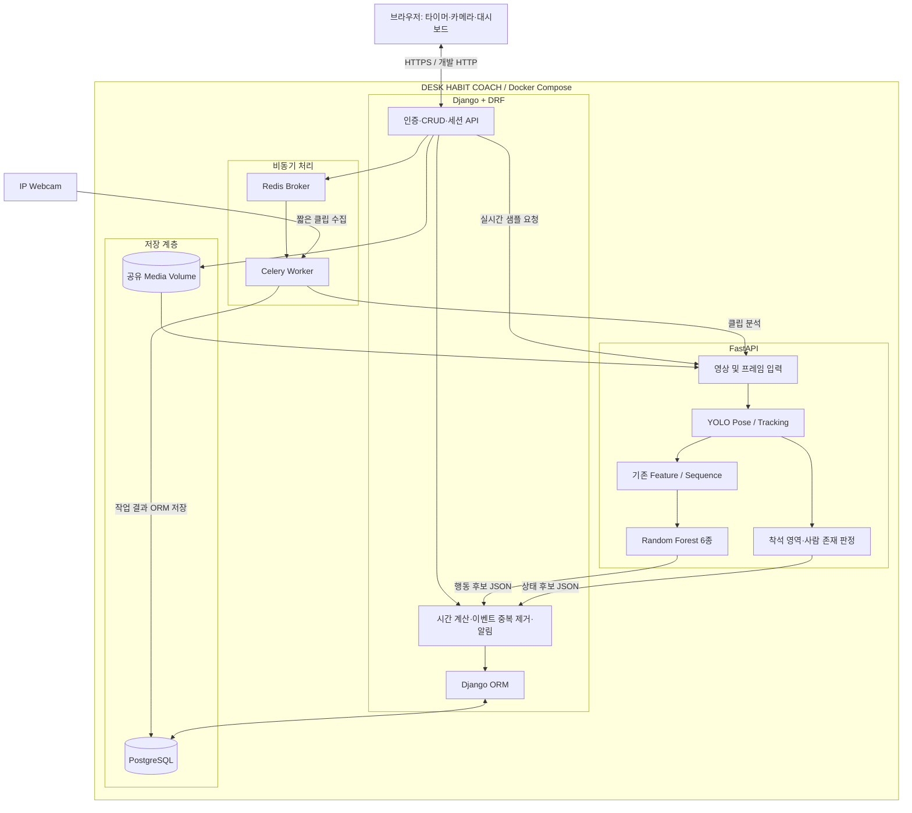
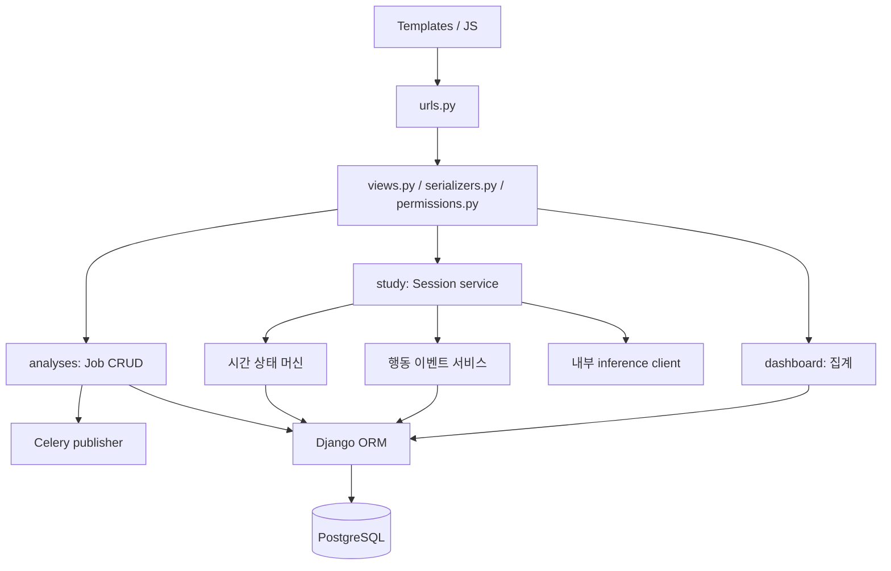
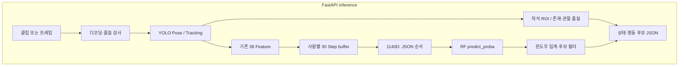
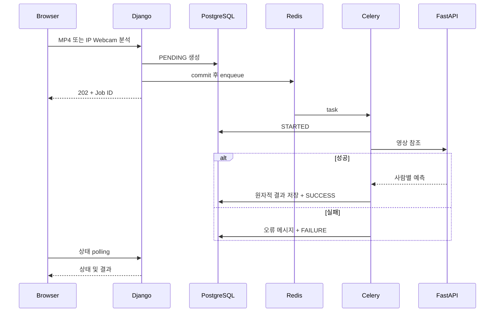
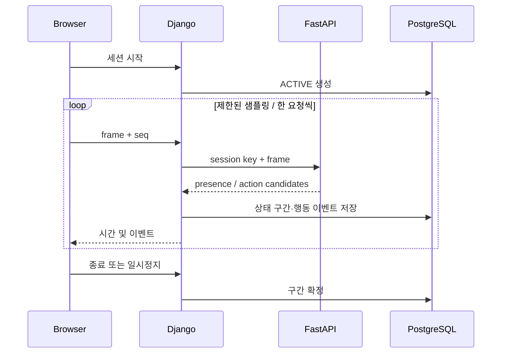
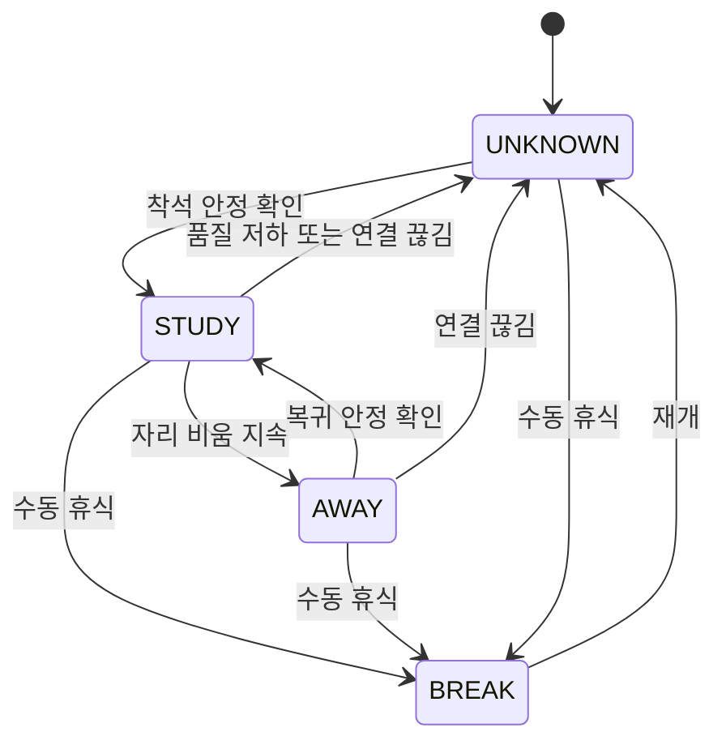
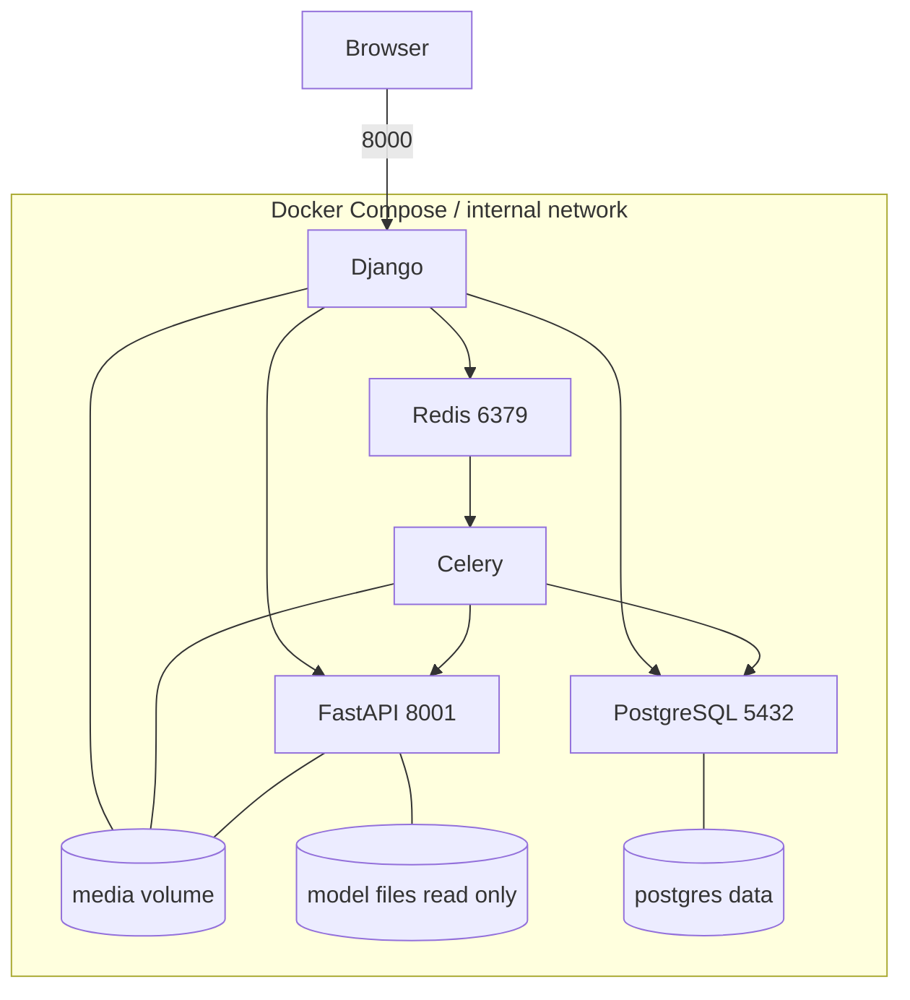
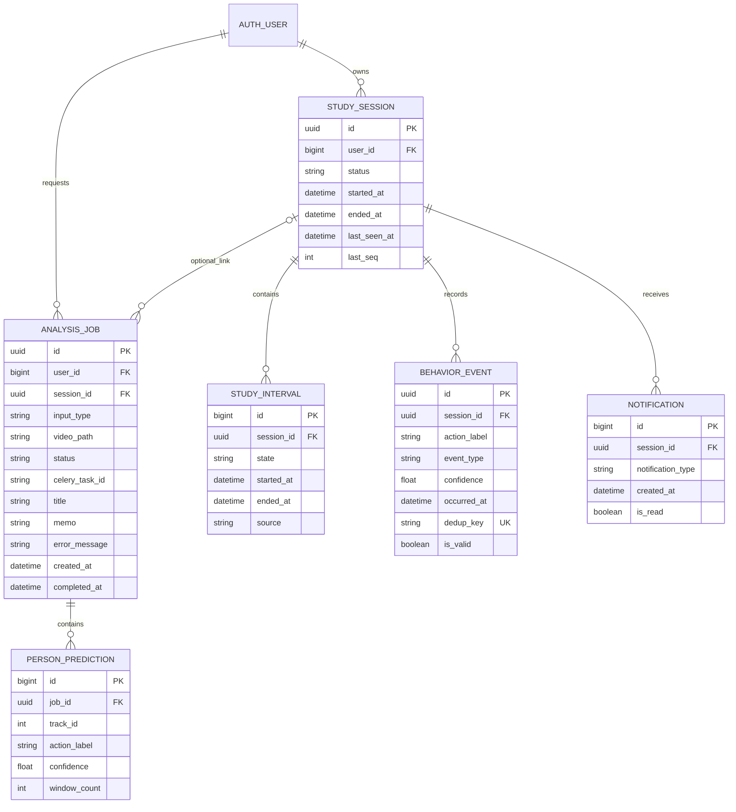
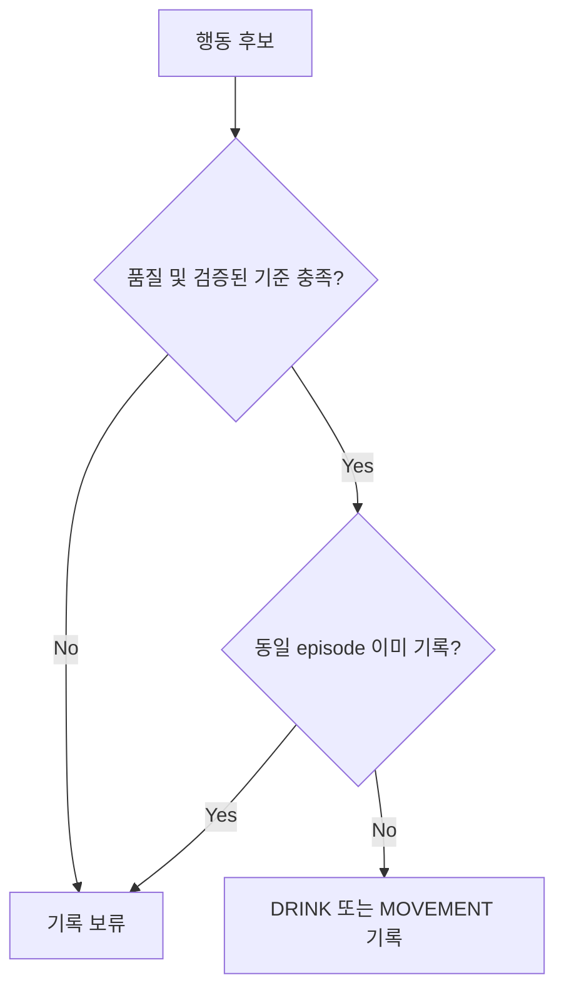
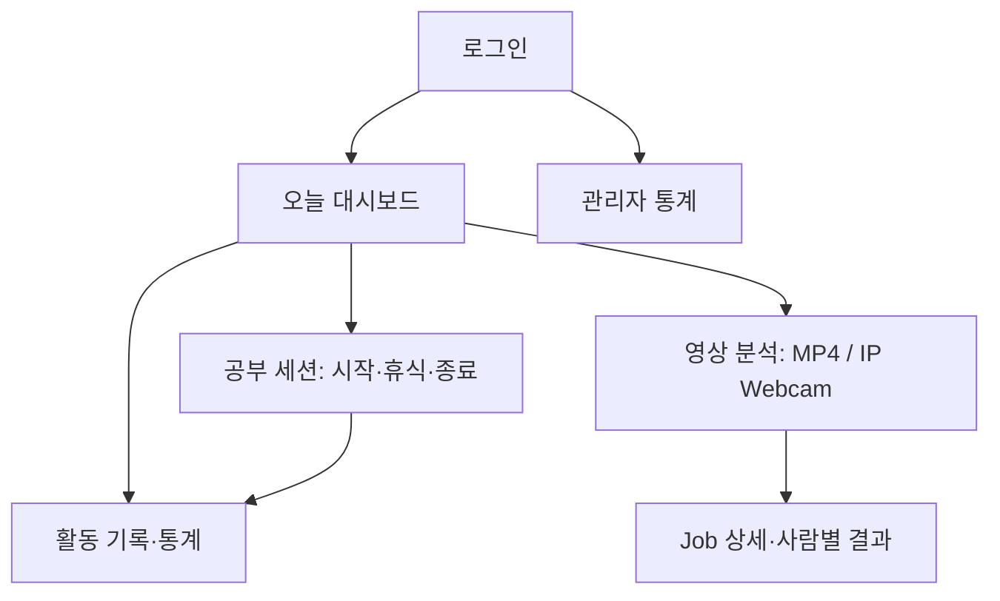

# DESK HABIT COACH 통합 개발 계획서 v2.0
2026-11-24 | 구현 전 설계 | 교과 10 기반

## 목적 및 범위
공부 세션 중 착석 기반 순공 추정시간, 휴식·자리 비움, 음료 섭취 및 움직임을 기록한다. 실제 집중력, 수분량, 의료적 자세 판단은 범위 밖. 기존 미션 인증 및 OK/NG 중심 기능은 제거한다.

- P0: 기존 RF 및 JSON 2개, MP4/IP Webcam 단시간 클립, 다중 인물, Django/DRF CRUD, FastAPI, Celery/Redis, PostgreSQL, Docker, 관리자, T01~T10.
- P1: 수동 타이머 → 자리 상태 자동 감지 → 실시간 행동 후보 및 중복 제거 → 일일/주간 리포트. 실시간 처리량 부족 시 클립 분석과 수동 타이머를 유지하고 자동 기능을 제한한다.
- P2: 선택형 휴식/음료 알림, 개인 목표, 기록 수정 확장, 성능 최적화.

## 구현 순서 및 파일 책임
```text
backend/
  config/                 # settings, urls, celery 설정
  analyses/               # models, serializers, views, permissions, tasks, admin
  study/                  # models, serializers, views, urls, admin
    services/
      session_service.py  # 세션 lifecycle, row lock
      time_engine.py      # 상태 구간·heartbeat·시간 집계
      event_service.py    # 행동 episode 중복 제거
      inference_client.py # 내부 FastAPI HTTP
  dashboard/              # views, 집계 서비스
  templates/              # dashboard, study, analyses, reports
  static/js/              # camera.js, study.js, analyses.js, charts.js
inference/
  main.py                 # FastAPI app
  routers/                # predictions.py, streams.py
  services/               # video, pose, tracking, features, sequence, classifier
  stream_state.py         # 세션별 buffer/TTL
  presence.py             # ROI 상태 후보
  models/                 # 기존 모델 산출물 (read-only)
compose.yaml
.env.example
docs/
```
1. 기존 모델·메타데이터 검증 및 FastAPI 클립 분석.
2. Django ORM/CRUD, Celery, Redis, Docker, IP Webcam 및 관리자 구현; T01~T10 통과.
3. StudySession/StudyInterval 및 수동 타이머, 상태 구간 테스트.
4. 브라우저 프레임 샘플링과 ROI 상태 감지, 연결 끊김 처리.
5. RF 실시간 후보 검증, 중복 제거, 대시보드 및 사용자 정정.
6. 독립 검증 데이터 평가, README 및 시연 준비.

## 운영 기준
서버 시간 UTC 저장, 사용자 일일 집계는 Asia/Seoul 기준 자정에서 구간 분할. 수동 휴식은 자동 상태보다 우선. 상태 합계는 전체 세션과 일치해야 한다. 브라우저 종료/네트워크 단절 시 heartbeat 만료로 UNKNOWN 정산, 장기 미접속 세션은 정책에 따라 종료. 원본 실시간 프레임은 저장하지 않는다. 클립 업로드는 소유자만 접근. 인증·CSRF·SSRF 방지, 환경변수, 제한적 재시도, 멱등성, DB 백업 적용.

## 제출 및 실행
루트 README에 목적, .env.example 복사, 모델 배치, docker compose up --build, migrate, createsuperuser, 접속 주소, 아키텍처·ERD·시퀀스, 정상/실패/관리자 시연 및 한계 기록. 기존 교과 요구사항과 실시간 확장을 구분한다.

---

# 시스템 아키텍처 v2.0

## 전체 시스템 — Docker Compose 5개 서비스

위 결과 화살표는 논리적 흐름이다. 클립 결과는 FastAPI → Celery → ORM, 실시간 결과는 FastAPI → Django → ORM 경로로 반환한다. FastAPI는 DB에 직접 접근하지 않는다.

## Django 내부

## AI 추론 내부

클립과 실시간 입력의 tracker/buffer는 격리한다. 실시간 세션별 상태는 메모리 TTL로 관리하고 초기 배포는 FastAPI 단일 프로세스. 재시작 시 buffer 초기화 및 UNKNOWN 처리. 학습 당시 샘플링 간격을 유지할 수 없으면 행동 추론을 보류한다.

## 클립 비동기 시퀀스 (교과 필수)

## 실시간 세션 시퀀스

브라우저 getUserMedia는 명시적 시작 후만 활성화. 초기에는 HTTP 샘플 전송, 동시 요청 1개, 크기·빈도 제한, timeout. 실시간 경로는 Celery 장기 작업으로 만들지 않는다. HTTPS 또는 localhost 필요. 프레임 원본은 기본 미저장. 연결 끊김은 UNKNOWN, 사용자 종료 시 카메라 track stop.

## 시간 상태 머신

STUDY는 착석 기반 추정이며 실제 집중 측정 아님. 수동 휴식 우선, 종료는 모든 상태에서 가능. 상태 구간은 겹치지 않으며 서버 시간 기준으로 계산한다.

## 배포

Django만 외부 공개. IP Webcam은 Worker가 허용된 주소로 접속. 모델·DB·Redis 포트는 내부 전용. GPU/CPU 자원 및 동시 추론 제한을 측정한다.


---

# ERD v2.0

## 제약 및 저장 정책
- 교과 핵심 auth_user, AnalysisJob, PersonPrediction 유지. job_id+track_id unique. 상태 PENDING/STARTED/SUCCESS/FAILURE.
- StudySession: ACTIVE/PAUSED/ENDED, 사용자당 열린 세션 하나(조건부 unique). session_id가 붙은 Job도 동일 소유자만 허용.
- StudyInterval: STUDY/BREAK/AWAY/UNKNOWN, 반열린 구간 [start,end), 세션당 열린 구간 하나. 트랜잭션과 row lock으로 중복·겹침 방지. 시간 합계는 구간에서 계산(캐시 사용 시 재계산 가능).
- BehaviorEvent: DRINK/MOVEMENT, 실제 RF label 유지, confidence는 모델 점수, dedup_key는 세션·행동 episode 식별자. 사용자 정정은 is_valid 또는 별도 감사 기록. 미션 테이블 제거.
- Notification은 P2 선택. 삭제 정책은 종료된 세션만 사용자 삭제 허용, 하위 구간·이벤트 cascade; 연결된 Job은 SET_NULL. 실행 중 Job 삭제 금지. 영상 파일은 commit 후 삭제.
- 기존 DB에 미션 기록이 있다면 백업 후 별도 마이그레이션. 기존 기록을 자동으로 공부 세션으로 변환하지 않는다.


---

# API 명세 v2.0
## Django / DRF (인증·소유권 검사)
| Method | URL | 기능 |
|---|---|---|
| POST/GET | /api/jobs/ | 클립 작업 생성·목록 |
| GET/PATCH/DELETE | /api/jobs/{id}/ | 상세·제목/메모 수정·삭제 |
| POST | /api/study/sessions/ | 세션 시작 |
| GET | /api/study/sessions/ | 내 세션 목록 |
| GET | /api/study/sessions/{id}/ | 상태·시간 합계 |
| POST | /api/study/sessions/{id}/frames/ | 실시간 샘플 분석 |
| POST | /api/study/sessions/{id}/pause/ | 수동 휴식 |
| POST | /api/study/sessions/{id}/resume/ | 재개 |
| POST | /api/study/sessions/{id}/end/ | 종료 |
| GET | /api/study/sessions/{id}/events/ | 행동 기록 |
| PATCH | /api/study/events/{id}/ | 오인식 기록 무효화 |
| GET | /api/dashboard/today/ | 일일 시간·행동 집계 |
| GET | /api/dashboard/weekly/ | 주간 집계 |
| GET | /api/admin/summary/ | 관리자 전용 작업 통계 |

Job POST multipart: input_type=upload 또는 ip_webcam, video 또는 허용된 camera_id. 202 + job_id; 잘못된 파일도 Job FAILURE 저장 후 4xx와 ID 반환. PATCH는 제목/메모만. 카메라 주소는 서버 허용 목록 사용.

Frame POST multipart: frame(JPEG), seq(단조 증가 정수). 서버 시간 사용. 세션 ACTIVE만 허용. 중복 seq는 재처리하지 않음, 과거 seq는 무시/409, 요청 과다 429. 응답 예시(가상 수치):
```json
{"session_id":"uuid","seq":42,"state":"STUDY","study_seconds":120,"break_seconds":0,"away_seconds":10,"unknown_seconds":5,"new_events":[{"action_label":"drink_return","event_type":"DRINK","confidence":0.91}]}
```
## FastAPI 내부 전용
| Method | URL | 기능 |
|---|---|---|
| GET | /health | 모델 준비 상태 |
| POST | /predict/video | 공유 볼륨 영상 참조 → 사람별 예측 |
| POST | /predict/frame | 세션별 프레임 → 상태·행동 후보 |
| DELETE | /streams/{key} | 세션 buffer 해제 |

영상 결과: model_version, predictions[{track_id, action_label, confidence, window_count}], processing_ms. 프레임 결과: seq, presence_candidate, quality_passed, track_count, action_candidates[], processing_ms. 입력 경로 정규화, 내부 인증, timeout, 크기 제한. DB 쓰기 없음. 브라우저 세션 ID를 내부 stream key로 매핑한다.


---

# AI 파이프라인 v2.0
기존 day6 RF joblib, rf_feature_columns.json, rf_training_info.json, day7~8 Pose/Feature/Tracking 재사용. 실제 classes_, n_features_in_, sequence_steps 및 feature 순서 검증. 30×38=1140 기준. 재학습은 교과 범위 밖.

| ID | 라벨 | 기록 |
|---|---|---|
| A001 | bend_return | 허리 움직임 |
| A002 | leg_raise_lower | 다리 움직임 |
| A003 | walk_turn_walk | 걷기 활동 |
| A004 | drink_return | 음료 섭취 동작 |
| A005 | sit_stand | 기립 활동 |
| A006 | wave | 팔 움직임 |

## 두 분석 분기 (Pose 공유)
1. 동작: 사람별 관절 → 기존 정규화·38 features → 30 step → RF → 윈도우 집계 → 품질/신뢰도/지속성 필터 → 이벤트 후보.
2. 시간: 지정 착석 ROI 내 단일 대상 존재 및 관절 품질 → 상태 후보. 상반신만 보이는 경우 착석 자체를 확정할 수 없으므로 착석 영역 존재로 표시. 다중 인물·가림·연결 장애는 UNKNOWN. 자리 비움은 정상 프레임에서 ROI 대상이 없을 때만 판단.

## 의사결정

RF는 폐쇄형 6종 분류이므로 미학습 행동도 높은 점수로 오분류 가능. UNKNOWN은 서비스 보류 상태이지 RF 클래스가 아니다. 초기 threshold는 검증 데이터로 결정하고, 동작 종료/재진입 및 cooldown을 조합해 중복 제거한다. 단순 연속 window 개수를 행동 횟수로 세지 않는다. 수분량·실제 집중·올바른 스트레칭을 추정하지 않는다.

실시간 프레임은 학습 당시 sampling cadence에 맞춰야 한다. 처리량 부족 시 행동 인식을 비활성화하고 수동 클립 분석으로 대체한다. 상태 감지 초기값: 복귀 3초, 부재 5초, heartbeat 5초 초과 UNKNOWN(검증 후 조정). 서버 시각 기준 상태 구간 계산, 마지막 유효 관측 이후 미확인 시간은 UNKNOWN으로 정산.


---

# 데이터 수집 v2.0
기존 모델 재학습 없이 실제 책상 환경 검증용 데이터를 수집한다. 참여자 동의, 촬영 범위 제한, 원본 보관 기간·삭제 정책 명시. 주변 사람 및 화면 개인정보 제외.

| 데이터 | 초기 목표 | 목적 |
|---|---|---|
| 6종 동작 | 각 5~10 클립, 5~8초 이상 필요 시 연장 | 기존 RF 검증 |
| 타이핑·마우스·휴대폰·얼굴 만지기·컵만 들기 | 각 5~10 클립 | 미학습 행동 오탐 평가 |
| 착석·복귀·자리 비움·가림·다중 인물 | 각 5회 이상 | 상태 전이 평가 |
| 연속 공부 세션 | 10~20분 3회 이상 | 중복 기록·시간 오차 평가 |

정면/측면, 조명, 거리, 컵 종류를 변화시키되 학습 입력 조건을 기록. CSV: clip_id, participant_alias, action_gt, start_sec, end_sec, camera_angle, lighting, notes. 상태 구간 및 실제 행동 횟수는 사람이 정답으로 기록. 임계값 조정용과 최종 평가용을 사람 또는 세션 단위로 분리. 소규모 결과는 일반화 성능으로 과장하지 않는다.


---

# 모델 및 시스템 평가 v2.0
| 항목 | 지표 |
|---|---|
| 6종 동작 | confusion matrix, class precision/recall/F1, macro F1 |
| 미학습 행동 | 잘못 기록된 이벤트 / 미학습 클립, 시간당 오탐 |
| 행동 이벤트 | 정답 이벤트와 시간 허용 오차 내 일대일 매칭, precision/recall, 횟수 MAE |
| 시간 기록 | 상태별 duration MAE, 착석 추정시간 오차, UNKNOWN 비율 |
| 상태 전이 | 자리 비움·복귀 감지 지연 |
| 시스템 | 클립 처리 p50/p95, 실시간 요청 지연·실패율, CPU/GPU, 메모리 |

threshold와 cooldown은 검증 세트에서 결정 후 고정하고 독립 평가. 정답 없는 인증율을 정확도로 표시하지 않는다. 카메라 각도·가림·다중 인물·네트워크 단절별 실패 사례 기록. 결과 수치는 실험 전 미정. README에 환경, 표본수, 모델 버전, 한계, 개선안을 기록한다.


---

# 테스트 v2.0
| ID | 통과 기준 |
|---|---|
| T01 | 기존 모델 6 classes, 1140 features 및 JSON 일치 |
| T02 | MP4 업로드 후 사람별 결과 조회 |
| T03 | IP Webcam 짧은 클립 수집 및 분석 |
| T04 | 다중 인물 Track ID별 결과 분리 |
| T05 | 비동기 작업 ID 즉시 반환 |
| T06 | PostgreSQL 작업·예측 영구 저장 |
| T07 | 사용자 A/B 조회·수정·삭제 격리 |
| T08 | 관리자 작업 목록·상태 차트 |
| T09 | 잘못된 파일/카메라 실패 메시지 및 FAILURE 저장 |
| T10 | Docker 재시작 후 DB 유지 |
| S01 | 세션 시작·종료, 카메라 해제 |
| S02 | 자리 비움·복귀 자동 상태 전이 |
| S03 | 수동 휴식 우선, 재개 시 UNKNOWN부터 시작 |
| S04 | 연결 단절·가림은 UNKNOWN, 시간 과대 누적 방지 |
| S05 | 음료·움직임 한 episode 한 기록, 중복 seq 재전송 안전 |
| S06 | 타이핑 등 미학습 행동 오탐 측정 |
| S07 | 상태 구간 합계가 전체 세션과 일치, 겹침 없음 |
| S08 | 다른 사용자 세션 접근 차단, 동시 활성 세션 방지 |
| S09 | 실시간 원본 프레임 미저장 확인 |
| S10 | 일일/주간 집계 및 오인식 정정 반영 |

T01~T10 먼저 완료. 실패 작업은 DB에 남기며 오류 메시지는 비밀정보 제외. Job SUCCESS는 분석 완료이지 행동 정확성 보증이 아니다. 실시간 서버 재시작 시 buffer 초기화 및 UNKNOWN 정산 테스트 포함.


---

# UI/UX v2.0
아이보리 #F7F8F4, 세이지 #315D49, 음료 #6895AD, 휴식 #D7BB85. Django Templates + CSS + JS + Chart.js.

| 페이지 | 구성 |
|---|---|
| /dashboard/ | 오늘 순공 추정시간, 목표, 휴식·부재·UNKNOWN, 음료·움직임 횟수, 타임라인 |
| /study/ | 타이머, 카메라 미리보기, 상태, 시작/휴식/재개/종료, 개인정보 안내 |
| /analyses/new/ | 교과용 MP4/IP Webcam 분석 |
| /analyses/{id}/ | 상태, 사람별 결과, 오류 안내 |
| /analyses/ | 내 작업 CRUD |
| /reports/ | 일일·주간 시간 및 행동 이벤트, 오인식 정정 |
| /staff/dashboard/ | 작업 상태·동작 분포, 실제 평가 결과와 구분 |

순공시간은 착석 기반 추정으로 명시. 음료 횟수는 마시는 동작 횟수이지 용량이 아님. 카메라 사용 중 표시 및 수동 정지 제공. 알림은 P2 선택형, 감시·딴짓 판정 없음.
