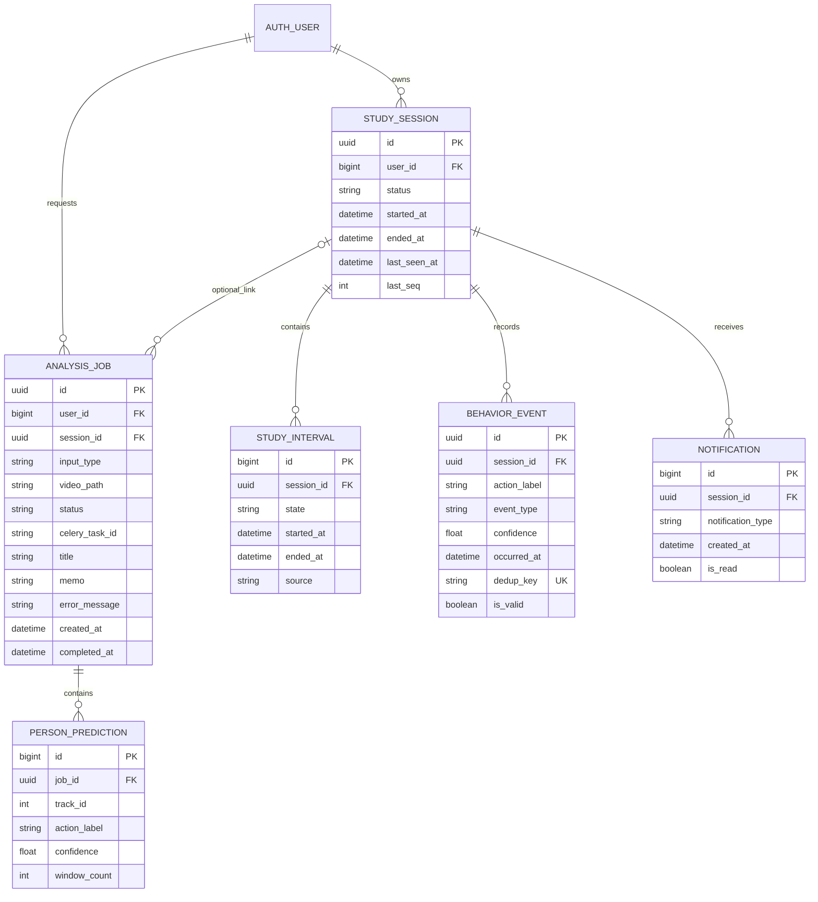

# ERD v2.0

## 제약 및 저장 정책
- 교과 핵심 auth_user, AnalysisJob, PersonPrediction 유지. job_id+track_id unique. 상태 PENDING/STARTED/SUCCESS/FAILURE.
- StudySession: ACTIVE/PAUSED/ENDED, 사용자당 열린 세션 하나(조건부 unique). session_id가 붙은 Job도 동일 소유자만 허용.
- StudyInterval: STUDY/BREAK/AWAY/UNKNOWN, 반열린 구간 [start,end), 세션당 열린 구간 하나. 트랜잭션과 row lock으로 중복·겹침 방지. 시간 합계는 구간에서 계산(캐시 사용 시 재계산 가능).
- BehaviorEvent: DRINK/MOVEMENT, 실제 RF label 유지, confidence는 모델 점수, dedup_key는 세션·행동 episode 식별자. 사용자 정정은 is_valid 또는 별도 감사 기록. 미션 테이블 제거.
- Notification은 P2 선택. 삭제 정책은 종료된 세션만 사용자 삭제 허용, 하위 구간·이벤트 cascade; 연결된 Job은 SET_NULL. 실행 중 Job 삭제 금지. 영상 파일은 commit 후 삭제.
- 기존 DB에 미션 기록이 있다면 백업 후 별도 마이그레이션. 기존 기록을 자동으로 공부 세션으로 변환하지 않는다.
