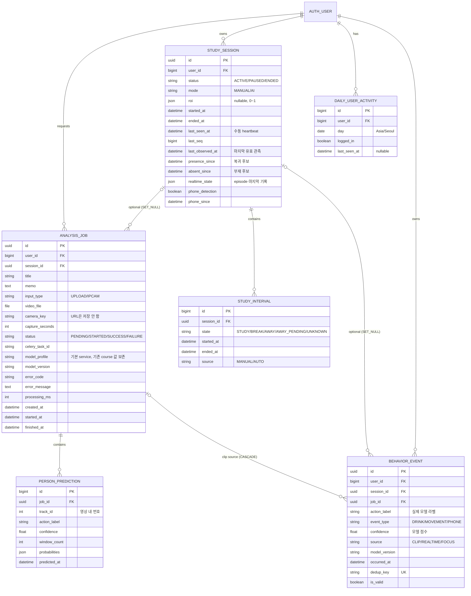

# ERD (구현 기준)

## 제약 및 저장 정책
- `DailyUserActivity`: `(day, user)` 고유. 성공한 로그인 여부와 계측 대상 요청 중 마지막 접속 시각만 저장하며 사용자가 삭제되면 함께 삭제된다. 요청 경로, IP, 기기 정보는 이 모델에 저장하지 않는다. 마이그레이션은 기존 이력을 채우지 않는다.
- `PersonPrediction`: (job, track_id) unique. `AnalysisJob` 상태는 Worker만 바꾼다.
- `StudySession`: 사용자당 열린(ACTIVE·PAUSED) 세션 1개 (조건부 unique `one_open_session_per_user`).
- `StudyInterval`: 반열린 구간 [started_at, ended_at), 세션당 열린 구간 1개 (`one_open_interval_per_session`). 상태 변경은 `transaction.atomic` + `select_for_update`. 합계는 구간에서 계산.
- `BehaviorEvent.dedup_key`: 클립 `job:{id}`, 실시간 `rt:{session}:{event}:{시각}`, 휴대폰 `phone:{session}:{시각}`. 정정은 `is_valid=false`(집계 제외).
- 삭제: Job 삭제 시 예측·클립 행동 기록 CASCADE, 실행 중 Job 삭제 금지, 영상 파일은 DB commit 후 삭제. 세션 삭제 시 구간 CASCADE, 연결된 Job·행동 기록은 SET_NULL.
- Notification 테이블은 선택(P2) — 구현하지 않음.
