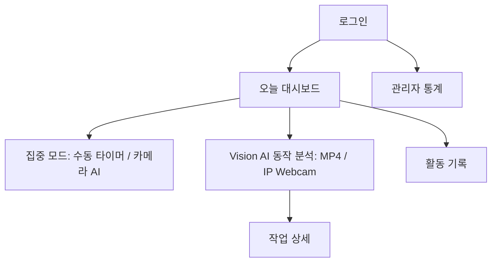

# UI/UX (구현 기준)
아이보리 #F7F8F4, 세이지 #315D49, 음료 #6895AD, 휴식 #D7BB85. Django Templates + CSS + JS.

| 페이지 | 구성 |
|---|---|
| /dashboard/ | 오늘 순공 추정시간·목표, 휴식·장기 자리 비움, 복귀 확인 중·확인 불가 안내, 음료(물방울)·움직임(손 흔들기·걷기 횟수), 타임라인, 최근 기록 |
| /study/ | 상태 배지, 현재 공부 시간, AI 추정/수동 기록/휴식·자리 비움·확인 불가 시간, 카메라 미리보기와 관절 표시, 선택 기능(휴대폰 감지·50분 휴식 알림, 기본 꺼짐) |
| /analyses/ | 교과 분석 화면: 업로드(드래그 앤 드롭)/IP Webcam 실시간 미리보기, 진행 단계, 사람별 결과, 기록 여부, 최근 이력 |
| /analyses/{id}/ | 상태, 사람별 결과, 제목·메모 수정, 삭제 |
| /reports/ | 최근 7일 상태별 시간·음료·손 흔들기·걷기, 행동 기록 오인식 정정 |
| /staff/dashboard/ | 작업 상태 원형 차트, 동작별 예측 막대, 최근 작업 (관리자만) |

**집중 모드 상태 표시**
| 상태 | 표시 |
|---|---|
| STUDY | 공부 중 (AI 추정) / 공부 중 (수동) |
| AWAY_PENDING | 자리 비움 · 복귀 확인 중 |
| BREAK | 휴식 중 (자동 휴식은 복귀 후 확정) |
| AWAY | 장기 자리 비움 |
| UNKNOWN | 카메라 확인 필요 / 연결 끊김 |

- 카메라 켜기 = AI 착석 추정 모드, 끄기 = 수동 타이머 모드. 새로고침하면 카메라가 꺼져 수동 모드로 맞춘다. 카메라 오류로 자동 전환하지 않는다(사용자가 끔).
- 공부 시간은 STUDY일 때만 늘고, AI 모드에서 서버 응답이 5초 넘게 없으면 화면 시계도 멈춘다.
- 음료 횟수는 서버에 기록된 경우에만 증가한다. 휴대폰 감지는 켰을 때만 동작하고 시간에서 빼지 않는다.
- 순공시간은 착석 기반 추정이며 실제 집중도가 아니다. 음료는 마시는 동작 횟수이지 용량이 아니다. 화면에 한 사람만 보이도록 안내한다.
