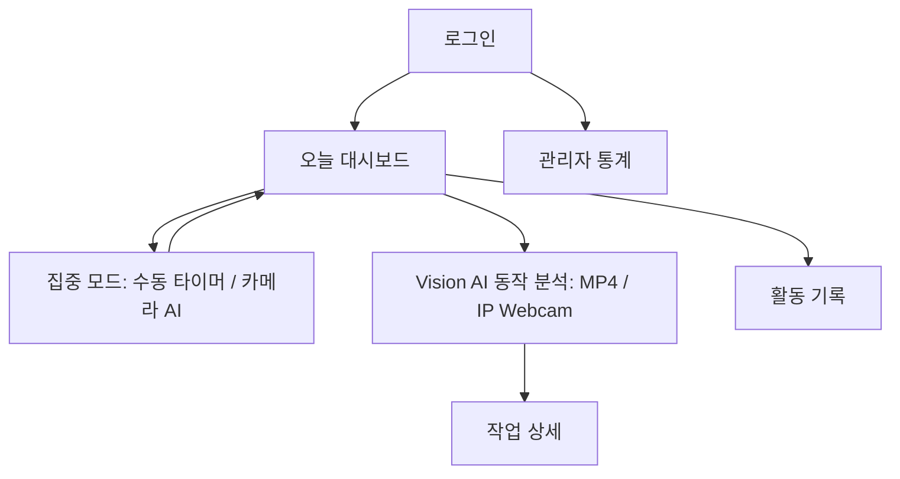

# UI/UX (구현 기준)
아이보리 #F7F8F4, 세이지 #315D49, 음료 #6895AD, 휴식 #D7BB85. Django Templates + CSS + JS.

| 페이지 | 구성 |
|---|---|
| /dashboard/ | 오늘 공부 시간·목표 달성률, 공부 시작·이어하기, 음료·휴식 시간·휴식 활동 요약, 이번 주 공부 시간 그래프, 오늘의 활동 기록·타임라인 |
| /study/ | 상태 배지, 현재 공부 시간, AI 추정/수동 기록/휴식·자리 비움·확인 불가 시간, 카메라 미리보기와 관절 표시, 선택 기능(휴대폰 감지·50분 휴식 알림, 기본 꺼짐), 카메라 패널의 짧은 안내 |
| /analyses/ | 교과 분석 화면: 업로드(드래그 앤 드롭)/IP Webcam 실시간 미리보기, 진행 단계, 사람별 결과, 기록 여부, `?job=`으로 결과 복원 |
| /analyses/{id}/ | 상태, 사람별 결과, 제목·메모 수정, 삭제 후 기록 화면 이동 |
| /reports/ | 7일·4주 통계 대시보드, 최근 행동 목록과 오인식 정정, 접이식 분석 이력(실패·미기록 포함) |
| /staff/dashboard/ | 관리자 전용 사용자 이용 현황, 최근 가입·오늘 접속 목록, 작업 상태 원형 차트, 동작별 예측 막대, 최근 작업 |

**오늘에서 집중 모드로**

- 열린 세션이 없으면 상단 카드의 **공부 시작하기**가 기존 세션 생성 API로 수동 타이머를 시작하고 집중 모드를 연다.
- 공부 중이거나 휴식 중인 열린 세션이 있으면 **공부 이어하기**로 같은 세션을 연다. 휴식 중에는 **다시 집중**을 눌러 공부를 재개한다.
- 카메라는 사용자가 **카메라 켜기**를 선택할 때만 요청한다. 집중 모드에서 세션 종료가 완료되면 오늘 화면으로 돌아온다.
- 이번 주 그래프는 월요일부터 일요일까지의 공부 시간을 표시한다. **기록 자세히 보기**는 기록 대시보드를 연다.

**집중 모드 상태 표시**
| 상태 | 표시 |
|---|---|
| STUDY | 공부 중 (AI 추정) / 공부 중 (수동) |
| AWAY_PENDING | 자리 비움 · 복귀 확인 중 |
| BREAK | 휴식 중 (자동 휴식은 복귀 후 확정) |
| AWAY | 장기 자리 비움 |
| UNKNOWN | 카메라 확인 필요 / 연결 끊김 |

- 카메라 켜기 = AI 착석 추정 모드, 끄기 = 수동 타이머 모드. 새로고침하면 카메라가 꺼져 수동 모드로 맞춘다. 카메라 오류로 자동 전환하지 않는다(사용자가 끔).
- 공부 시간은 STUDY일 때만 늘고, AI 모드에서 서버 응답이 5초 넘게 없으면 화면 시계도 멈춘다.
- 음료 횟수는 서버에 기록된 경우에만 증가한다. 휴대폰 감지는 켰을 때만 동작하고 시간에서 빼지 않는다.
- 카메라 패널에 “실시간 영상은 저장하지 않으며, AI 공부 시간은 사람 감지 기반 추정값입니다.”를 표시한다. 영상 분석은 공통 분석 메뉴에서 연다.

**행동 표시명**

화면과 그래프에서 `drink_return`은 음료 섭취, `wave`는 어깨 스트레칭, `walk_turn_walk`는 잠깐 자리 비움, `other`는 기타 행동으로 표시한다. 음료 섭취와 어깨 스트레칭은 횟수로 표시한다. 잠깐 자리 비움 동작 기록과 타이머의 휴식·장기 자리 비움 판정은 별도로 표시한다.

**활동 기록 대시보드**

- 기본 조회는 오늘을 포함한 최근 7일을 일별로 표시한다. 최근 4주는 오늘을 포함한 28일을 연속된 7일 단위 네 구간으로 표시한다.
- 상단에는 총 공부 시간, 휴식 시간, 음료 섭취 횟수, 휴식 활동 횟수를 표시한다. 휴식 활동은 유효한 움직임 기록 횟수다.
- Chart.js로 시간 누적 막대와 사용 비율 도넛, 음료 막대와 목표선, 어깨 스트레칭·잠깐 자리 비움 그룹 막대를 그린다. 공부 시간은 AI 추정과 수동 기록으로 나누며, 자리 비움에는 복귀 확인 중인 시간이 포함된다. 음료 목표는 일간 기준값을 사용하고 주별 화면에서는 일간 목표의 7배를 적용한다.
- 행동 목록에서 오인식으로 표시하거나 정정을 취소하면 현재 조회 기간의 통계가 갱신된다. 상세 분석 이력은 기본적으로 접혀 있으며, 펼쳐서 각 작업의 상세 화면과 제목·메모 수정 및 삭제 기능에 접근한다.
- 좁은 화면에서는 KPI가 2열, 차트가 1열로 배치된다. 차트별 데이터가 없으면 빈 상태를 표시한다.

**관리자 사용자 이용 현황**

- Asia/Seoul 날짜를 기준으로 누적 가입, 오늘 가입·로그인·접속·실제 이용, 최근 7일 추이를 상단에 표시한다. 각 일별 지표는 동일 사용자 한 명을 한 번만 센다.
- 로그인은 성공한 인증을 뜻하며 가입 시 자동 로그인을 포함한다. 접속은 로그인 후 서비스 화면이나 기능에 성공적으로 요청한 경우다. 관리자 화면, 자동 프레임·하트비트·상태 폴링은 접속 대상에서 제외한다. `last_login`은 오늘 로그인 집계를 보완하는 데만 사용한다.
- 실제 이용은 하루에 1초 이상 공부 시간이 집계됐거나 분석 작업을 요청한 사용자다. 같은 사용자가 두 기능을 모두 이용해도 한 번만 센다.
- 최근 가입자 20명과 오늘 접속자를 별도로 표시한다. 가입일, 최근 수집 접속 시각, 오늘 AI·수동 공부 시간, 오늘 요청한 분석 작업 수를 확인할 수 있다. 오늘 접속 목록은 페이지당 20명이다.
- 로그인·접속 기록은 배포 후 수집한다. 최근 7일 차트에서 최초 수집 날짜 이전의 해당 값과 계정의 미수집 접속 시각은 공란 또는 미수집으로 표시한다. 첫날 수치는 수집 시작 이후의 관측값이다.
