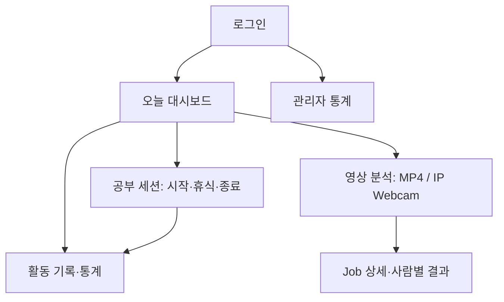

# UI/UX v2.0
아이보리 #F7F8F4, 세이지 #315D49, 음료 #6895AD, 휴식 #D7BB85. Django Templates + CSS + JS + Chart.js.

| 페이지 | 구성 |
|---|---|
| /dashboard/ | 오늘 순공 추정시간, 목표, 휴식·부재·UNKNOWN, 음료·움직임 횟수, 타임라인 |
| /study/ | 타이머, 카메라 미리보기, 상태, 시작/휴식/재개/종료, 개인정보 안내 |
| /analyses/new/ | 교과용 MP4/IP Webcam 분석 |
| /analyses/{id}/ | 상태, 사람별 결과, 오류 안내 |
| /analyses/ | 내 작업 CRUD |
| /reports/ | 일일·주간 시간 및 행동 이벤트, 오인식 정정 |
| /staff/dashboard/ | 작업 상태·동작 분포, 실제 평가 결과와 구분 |

순공시간은 착석 기반 추정으로 명시. 음료 횟수는 마시는 동작 횟수이지 용량이 아님. 카메라 사용 중 표시 및 수동 정지 제공. 알림은 P2 선택형, 감시·딴짓 판정 없음.
